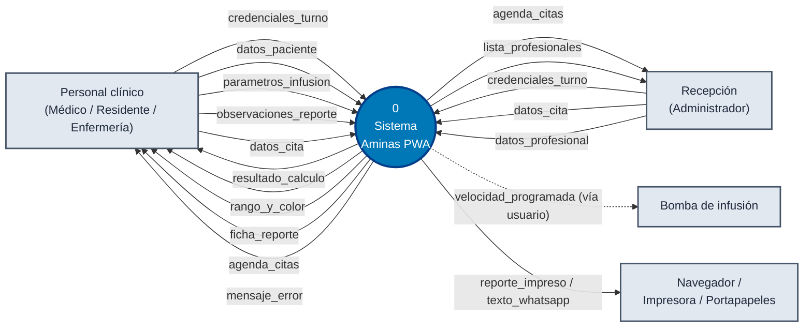
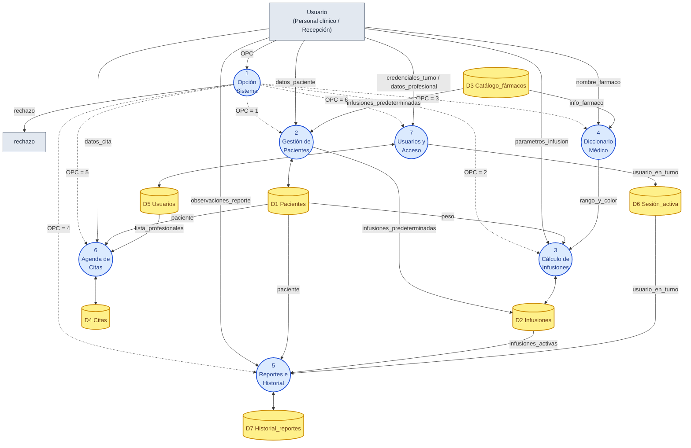
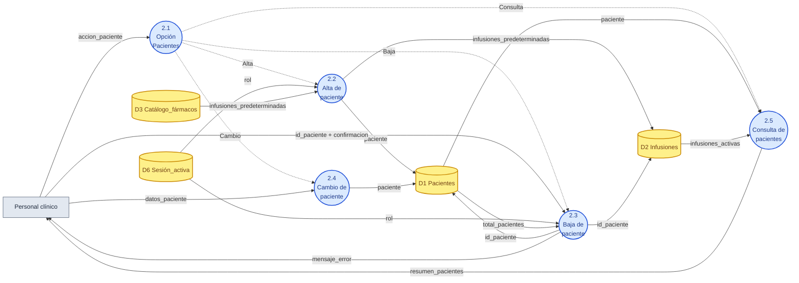
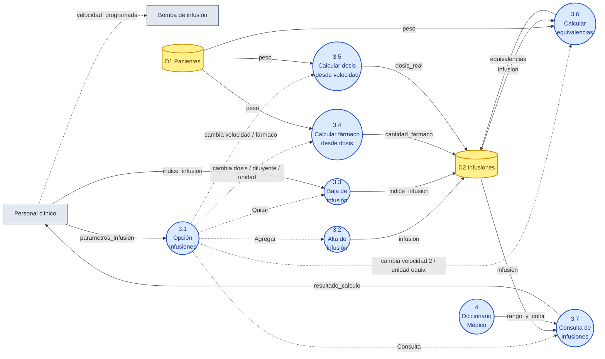
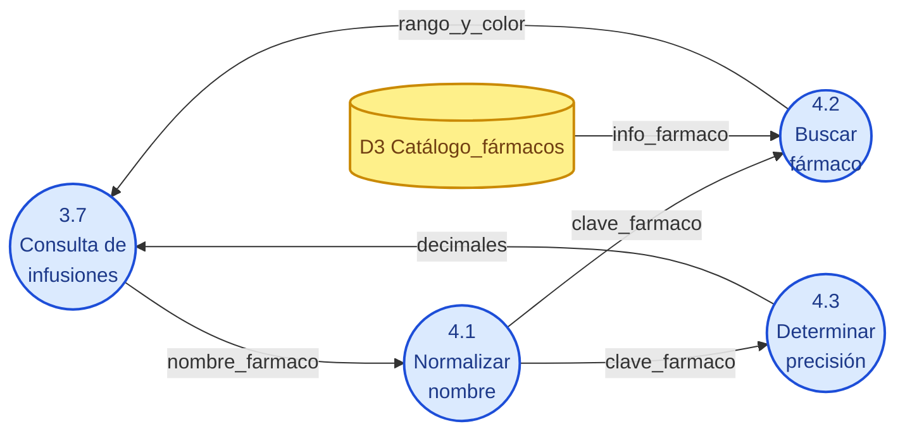
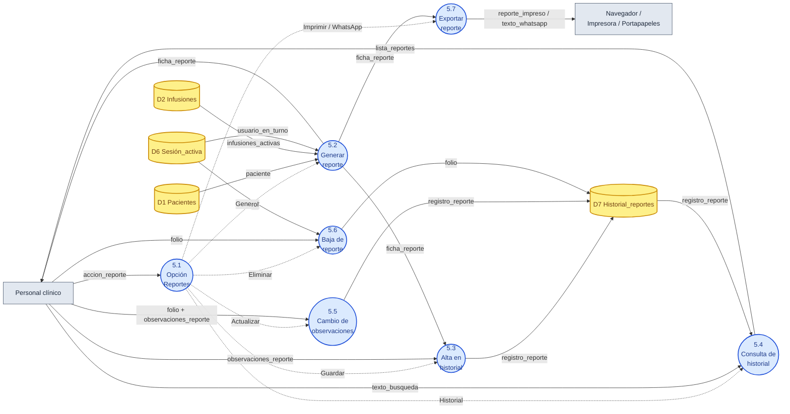
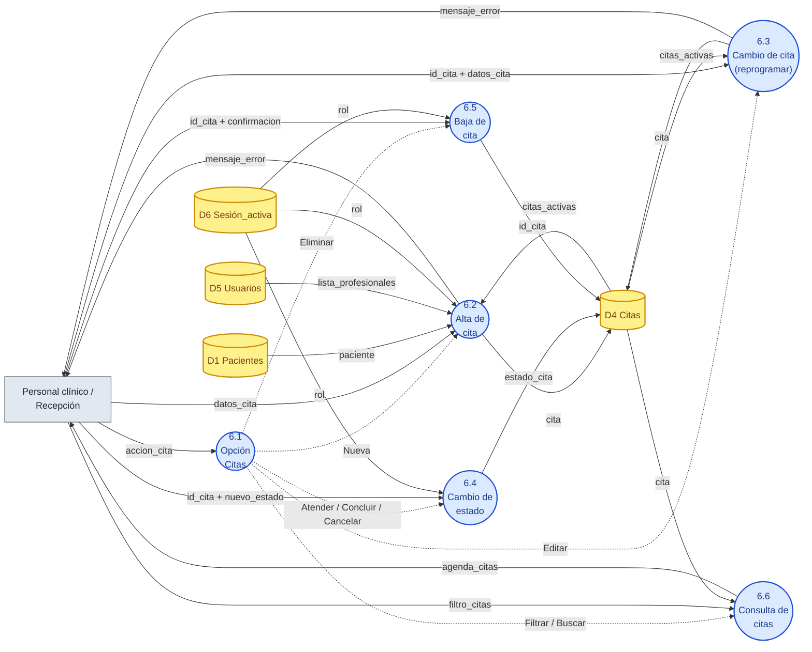
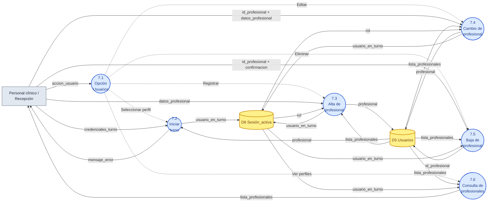

# Modelo de Comportamiento — Diagramas de Flujo de Datos (DFD) · Aminas PWA

> **Análisis Estructurado Moderno (Yourdon).** Actualiza el diagrama de contexto y el DFD de la primera versión, que solo incluía la calculadora. Ahora cubre los **6 módulos** de la versión final (rama `develop`, commit `e3e1130`): Pacientes, Cálculo de Infusiones, Diccionario Médico, Reportes e Historial, Citas y Usuarios.
>
> Los nombres de flujos y almacenes de este documento son **exactamente** los que se definen en el Diccionario de Datos del proyecto.

---

## 0. Notación y convenciones

| Símbolo | Significado | Cómo se ve en los diagramas |
| :--- | :--- | :--- |
| Círculo / burbuja | **Proceso** (transforma datos). Se numera jerárquicamente: `6` → `6.1`, `6.2`… | `(( 6.2 Agendar cita ))` |
| Rectángulo | **Terminador** (entidad externa) | Caja gris |
| Cilindro amarillo | **Almacén de datos** (`D1`…`D7`). En papel se dibuja con dos líneas paralelas | Cilindro |
| Flecha continua | **Flujo de datos** (lleva datos con nombre) | `──>` |
| Flecha punteada | **Flujo de control** (activa un proceso, no lleva datos), p. ej. `OPC = 1` | `- - ->` |

### Almacenes de datos del sistema

| Almacén | Nombre | Implementación física (`localStorage`) |
| :---: | :--- | :--- |
| **D1** | Pacientes | `aminas_pwa_data` → `patients[]` (id, nombre, peso) |
| **D2** | Infusiones | `aminas_pwa_data` → `patients[].meds[]` |
| **D3** | Catálogo_fármacos | Constantes `medInfo` y `defaultMeds` (`js/core/catalogoMedicamentos.js`) |
| **D4** | Citas | `aminas_citas_data` |
| **D5** | Usuarios | `aminas_usuarios_data` |
| **D6** | Sesión_activa | `aminas_auth_data` |
| **D7** | Historial_reportes | `aminas_historial_data` |

### Terminadores

| Terminador | Descripción |
| :--- | :--- |
| **Personal clínico** | Médico Pediatra, Médico Residente y Enfermero/a. Captura pacientes e infusiones, recibe cálculos y genera reportes. |
| **Recepción** | Administrador / Recepción. Agenda citas y administra al personal. |
| **Bomba de infusión** | Dispositivo físico. Recibe **indirectamente** la velocidad (ml/h) que el usuario programa a mano. |
| **Navegador / Impresora / Portapapeles** | Entorno del dispositivo que recibe el reporte impreso (PDF) o el texto copiado para WhatsApp. |

---

## 1. Diagrama de Contexto (actualizado)



> El sistema completo es la burbuja `0`. Los almacenes **no** se dibujan en el diagrama de contexto (Yourdon) porque son internos al sistema.

---

## 2. Diagrama 0 (Primer nivel)

El proceso `1. Opción Sistema` recibe la opción del menú (`OPC`) y activa, con un **flujo de control**, el módulo correspondiente. Es el mismo estilo que se vio en clase.

| OPC | Proceso activado | Pantalla real |
| :---: | :--- | :--- |
| 1 | **2. Gestión de Pacientes** | Dashboard + pestañas de la calculadora |
| 2 | **3. Cálculo de Infusiones** | Calculadora |
| 3 | **4. Diccionario Médico** | Rango y color junto a cada fármaco |
| 4 | **5. Reportes e Historial** | Modal de reporte + vista Historial |
| 5 | **6. Agenda de Citas** | Vista Citas |
| 6 | **7. Usuarios y Acceso** | Modal de perfiles |



> **Balanceo con el diagrama de contexto:** todos los flujos que entran y salen de `0` aparecen aquí como entradas y salidas de los procesos 2 a 7. Las flechas `<-->` indican lectura y escritura del mismo almacén.
>
> **Control de acceso:** los procesos 2, 5, 6 y 7 leen el `rol` de **D6 Sesión_activa** para validar permisos; el acceso al proceso 3 se valida al entrar a la calculadora. Para que el diagrama sea legible, esos flujos `rol` no se dibujan en el Diagrama 0; sí aparecen en los DFD de cada proceso. Las reglas vienen de la matriz de permisos (matriz RBAC de `js/core/permisosService.js`). Si el rol no tiene permiso, el proceso responde con `mensaje_error` y no modifica el almacén.

---

## 3. Diagramas de Flujo de Datos por proceso (explosión de cada burbuja)

Cada módulo de catálogo sigue el patrón que pide la materia: un **selector de opción** (`x.1`) activa **Alta, Baja, Cambio y Consulta**.

### 3.1 DFD 2 — Gestión de Pacientes

| Proceso | Descripción | Regla |
| :--- | :--- | :--- |
| 2.1 Opción Pacientes | Recibe la acción del usuario | — |
| 2.2 Alta de paciente | Crea un paciente con id consecutivo (`nextPatientId`) y le copia las infusiones predeterminadas del catálogo | Rol Médico o Residente |
| 2.3 Baja de paciente | Elimina el paciente y sus infusiones | Solo Médico Pediatra; debe quedar al menos 1 paciente; requiere confirmación |
| 2.4 Cambio de paciente | Actualiza nombre (título editable) y peso (kg) | Peso numérico ≥ 0 |
| 2.5 Consulta de pacientes | Muestra las tarjetas del dashboard con número de infusiones activas y abre al paciente seleccionado | — |



### 3.2 DFD 3 — Cálculo de Infusiones

Es el **núcleo** del sistema. El cálculo es **bidireccional**: si el usuario captura la dosis se calcula el fármaco a diluir; si captura la velocidad o el fármaco se calcula la dosis real.

| Proceso | Descripción | Fórmula / regla (`js/core/calculoFisiologico.js`) |
| :--- | :--- | :--- |
| 3.1 Opción Infusiones | Detecta qué campo cambió | — |
| 3.2 Alta de infusión | Agrega una fila de medicamento vacía (diluyente 12 ml, velocidad 1 ml/h) | — |
| 3.3 Baja de infusión | Quita la fila del medicamento | — |
| 3.4 Calcular fármaco desde dosis | `farmaco_mg = (dosis × peso × vol_final × 60) / (1000 × velocidad)` para mcg/kg/min | Peso > 0, velocidad > 0, vol_final > 0 |
| 3.5 Calcular dosis desde velocidad | `dosis = (farmaco_mg × 1000 × velocidad) / (peso × vol_final × 60)` para mcg/kg/min | Peso > 0; si no, limpia el campo |
| 3.6 Calcular equivalencias | Equivalencia 1 = dosis a **1 ml/h**; Equivalencia 2 = dosis a la **Velocidad 2** | Misma fórmula de 3.5 con otra velocidad |
| 3.7 Consulta de infusiones | Muestra la tabla (escritorio) o tarjetas (móvil) con rango y color | Usa 4. Diccionario Médico |



### 3.3 DFD 4 — Diccionario Médico

El catálogo de fármacos es **de referencia y solo de consulta**: sus valores (rangos terapéuticos pediátricos) son datos clínicos institucionales fijos y no deben modificarse desde la aplicación. Por eso este módulo no tiene alta, baja ni cambio.

| Proceso | Descripción |
| :--- | :--- |
| 4.1 Normalizar nombre | Quita espacios y convierte a minúsculas (`Dopamina` → `dopamina`) |
| 4.2 Buscar fármaco | Busca en `medInfo`; si no existe, devuelve vacío (sin color ni rango) |
| 4.3 Determinar precisión | Norepinefrina, adrenalina y milrinona usan **3 decimales**; el resto 1 o 2 |



### 3.4 DFD 5 — Reportes e Historial de Entrega de Guardia

| Proceso | Descripción | Regla |
| :--- | :--- | :--- |
| 5.1 Opción Reportes | Selecciona la acción | — |
| 5.2 Generar reporte | Toma el paciente, filtra las **infusiones activas** (dosis > 0 o velocidad > 0, con nombre) y arma la ficha con fecha, hora y firma del usuario en turno | Rol clínico |
| 5.3 Alta en historial | Guarda una **copia fija (snapshot)** del reporte con folio consecutivo | Rol clínico; si ya se guardó, actualiza en lugar de duplicar |
| 5.4 Consulta de historial | Lista los reportes del más reciente al más antiguo, con búsqueda por paciente, profesional u observaciones | — |
| 5.5 Cambio de observaciones | Reabre un reporte guardado y actualiza sus observaciones | Los datos clínicos del snapshot no cambian |
| 5.6 Baja de reporte | Elimina un reporte del historial | Solo Médico Pediatra; confirmación |
| 5.7 Exportar reporte | Imprime / guarda en PDF o copia el texto formateado para WhatsApp | — |



### 3.5 DFD 6 — Agenda de Citas

| Proceso | Descripción | Regla |
| :--- | :--- | :--- |
| 6.1 Opción Citas | Selecciona la acción | — |
| 6.2 Alta de cita | Valida campos obligatorios y que no haya empalme; registra la cita con estado `PROGRAMADA` | Rol Médico, Residente o Recepción |
| 6.3 Cambio de cita (editar / reprogramar) | Modifica paciente, profesional, fecha, hora, motivo o notas; si cambia fecha u hora suma una reprogramación | Mismas reglas que 6.2, excluyendo la propia cita |
| 6.4 Cambio de estado | `PROGRAMADA → EN_CURSO → COMPLETADA`, o `→ CANCELADA` | Atender/concluir: Médico o Residente. Cancelar: Médico o Recepción |
| 6.5 Baja de cita | Elimina el registro | Médico o Recepción; confirmación |
| 6.6 Consulta de citas | Filtra por estado y texto, ordena por fecha y hora, y calcula contadores (total, hoy, programadas) | — |



### 3.6 DFD 7 — Usuarios y Control de Acceso

| Proceso | Descripción | Regla |
| :--- | :--- | :--- |
| 7.1 Opción Usuarios | Selecciona la acción en el modal de perfiles | — |
| 7.2 Iniciar turno | Valida la contraseña del perfil elegido y lo guarda como usuario en turno | Contraseña correcta |
| 7.3 Alta de profesional | Registra un profesional nuevo y le inicia el turno | Rol con gestión (Médico o Recepción); cédula única; contraseña ≥ 3 caracteres y confirmada |
| 7.4 Cambio de profesional | Edita nombre, cédula, rol, especialidad, turno y contraseña (vacía = conservar) | Gestión, o el propio perfil sin cambiar rol |
| 7.5 Baja de profesional | Elimina al profesional | Gestión; no el perfil en turno; debe quedar ≥ 1 Médico Pediatra |
| 7.6 Consulta de profesionales | Muestra las tarjetas de perfiles con su rol y turno | — |



---

## 4. Especificación de procesos primitivos (mini-especificaciones)

Pseudocódigo estructurado de los procesos con lógica de negocio más importante.

**3.4 Calcular fármaco desde dosis**
```text
SI peso <= 0 O velocidad <= 0 O vol_final <= 0 O dosis <= 0 ENTONCES
    no calcular (dejar campo como está)
SI NO
    SEGÚN unidad_dosis
        "mcg/kg/min": farmaco_mg = (dosis * peso * vol_final * 60) / (1000 * velocidad)
        "mcg/kg/h"  : farmaco_mg = (dosis * peso * vol_final) / (1000 * velocidad)
        "mg/kg/h"   : farmaco_mg = (dosis * peso * vol_final) / velocidad
    SI unidad_farmaco = "mcg" ENTONCES cantidad_farmaco = farmaco_mg * 1000
    SI NO cantidad_farmaco = farmaco_mg
    redondear cantidad_farmaco a "decimales" (proceso 4.3)
```

**3.5 Calcular dosis desde velocidad**
```text
SI peso <= 0 ENTONCES limpiar cantidad_farmaco y terminar
farmaco_mg = cantidad_farmaco / 1000 SI unidad_farmaco = "mcg", SI NO cantidad_farmaco
SEGÚN unidad_dosis
    "mcg/kg/min": dosis = (farmaco_mg * 1000 * velocidad) / (peso * vol_final * 60)
    "mcg/kg/h"  : dosis = (farmaco_mg * 1000 * velocidad) / (peso * vol_final)
    "mg/kg/h"   : dosis = (farmaco_mg * velocidad) / (peso * vol_final)
redondear dosis a "decimales" (proceso 4.3)
```

**6.2 Alta de cita**
```text
SI rol NO está en {MEDICO_PEDIATRA, RESIDENTE, RECEPCION} ENTONCES mensaje_error "Acción no permitida"
SI falta paciente, profesional, fecha, hora o motivo ENTONCES mensaje_error con los campos faltantes
BUSCAR en D4 una cita con mismo profesional, fecha y hora con estado PROGRAMADA o EN_CURSO
SI existe ENTONCES mensaje_error "Horario ocupado"
SI NO
    id = mayor id de D4 + 1
    guardar cita con estado = PROGRAMADA y fecha_registro = ahora
```

**7.5 Baja de profesional**
```text
SI rol NO tiene permiso de gestión ENTONCES mensaje_error
SI id_profesional = id del usuario en turno ENTONCES mensaje_error "No puedes eliminar el perfil activo"
SI el profesional es MEDICO_PEDIATRA Y es el único ENTONCES mensaje_error
SI el usuario confirma ENTONCES eliminar de D5
```
