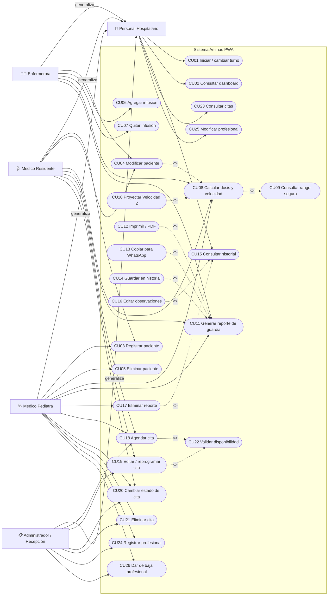

# Casos de Uso Detallados — Aminas PWA

> **Diseño Orientado a Objetos.** Este documento define el **catálogo único de casos de uso** del sistema final (rama `develop`, commit `e3e1130`) y su especificación detallada.
> Esta es la numeración oficial de casos de uso; los diagramas de secuencia y colaboración la usan.

---

## 1. Actores

| Actor | Tipo | Descripción | Hereda de |
| :--- | :--- | :--- | :--- |
| **Personal Hospitalario** | Abstracto (base) | Cualquier profesional registrado en el sistema. Puede iniciar turno, ver el dashboard, las citas, el historial y su propio perfil. | — |
| **Médico Pediatra** | Principal | Máxima autoridad clínica: todas las operaciones, incluida la baja de pacientes, de reportes y la gestión de usuarios. | Personal Hospitalario |
| **Médico Residente** | Principal | Opera la calculadora, da de alta pacientes, agenda y atiende citas, genera reportes. No elimina pacientes ni reportes. | Personal Hospitalario |
| **Enfermero/a** | Principal | Registra peso y ajusta bombas, genera y guarda reportes de entrega de guardia. Solo consulta citas. | Personal Hospitalario |
| **Administrador / Recepción** | Principal | Agenda, reprograma, cancela y elimina citas; administra al personal. **No** accede a la calculadora. | Personal Hospitalario |
| **Bomba de infusión** | Secundario (pasivo) | Recibe manualmente la velocidad calculada. | — |

---

## 2. Catálogo de casos de uso

| CU | Nombre | Módulo | Actores | Relaciones |
| :---: | :--- | :--- | :--- | :--- |
| CU01 | Iniciar / cambiar turno | Usuarios | Todos | — |
| CU02 | Consultar dashboard | Pacientes | Todos | — |
| CU03 | Registrar paciente | Pacientes | Médico, Residente | — |
| CU04 | Modificar paciente (nombre y peso) | Pacientes | Médico, Residente, Enfermero/a | `<<include>>` CU08 (recalcula) |
| CU05 | Eliminar paciente | Pacientes | Médico | — |
| CU06 | Agregar infusión | Infusiones | Médico, Residente, Enfermero/a | — |
| CU07 | Quitar infusión | Infusiones | Médico, Residente, Enfermero/a | — |
| CU08 | Calcular dosis y velocidad | Infusiones | Médico, Residente, Enfermero/a | `<<include>>` CU09 |
| CU09 | Consultar rango seguro del fármaco | Diccionario | Médico, Residente, Enfermero/a | — |
| CU10 | Proyectar Velocidad 2 | Infusiones | Médico, Residente, Enfermero/a | `<<extend>>` CU08 |
| CU11 | Generar reporte de entrega de guardia | Reportes | Médico, Residente, Enfermero/a | — |
| CU12 | Imprimir / guardar reporte en PDF | Reportes | Médico, Residente, Enfermero/a | `<<extend>>` CU11 |
| CU13 | Copiar resumen para WhatsApp | Reportes | Médico, Residente, Enfermero/a | `<<extend>>` CU11 |
| CU14 | Guardar reporte en historial | Historial | Médico, Residente, Enfermero/a | `<<extend>>` CU11 |
| CU15 | Consultar historial de reportes | Historial | Todos | — |
| CU16 | Editar observaciones de un reporte | Historial | Médico, Residente, Enfermero/a | `<<extend>>` CU15 |
| CU17 | Eliminar reporte del historial | Historial | Médico | `<<extend>>` CU15 |
| CU18 | Agendar cita | Citas | Médico, Residente, Recepción | `<<include>>` CU22 (valida empalme) |
| CU19 | Editar / reprogramar cita | Citas | Médico, Residente, Recepción | `<<include>>` CU22 |
| CU20 | Cambiar estado de la cita | Citas | Médico, Residente (atender/concluir); Médico, Recepción (cancelar) | — |
| CU21 | Eliminar cita | Citas | Médico, Recepción | — |
| CU22 | Validar disponibilidad de horario | Citas | (interno) | — |
| CU23 | Consultar y filtrar citas | Citas | Todos | — |
| CU24 | Registrar profesional | Usuarios | Médico, Recepción | — |
| CU25 | Modificar profesional | Usuarios | Médico, Recepción (cualquiera); todos (su propio perfil) | — |
| CU26 | Dar de baja profesional | Usuarios | Médico, Recepción | — |

> **Altas, bajas, cambios y consultas por catálogo:**
> Pacientes (CU03, CU05, CU04, CU02) · Infusiones (CU06, CU07, CU08, CU08) · Citas (CU18, CU21, CU19/CU20, CU23) · Usuarios (CU24, CU26, CU25, CU01) · Historial (CU14, CU17, CU16, CU15) · Catálogo de fármacos: solo consulta (CU09), porque son datos clínicos de referencia.

---

## 3. Diagrama de casos de uso (alto nivel, numeración unificada)

> Para no saturar el diagrama, las asociaciones de Médico y Residente con CU06, CU07, CU10, CU12–CU14 y CU16 se omiten; la tabla del punto 2 es la referencia completa.

---

## 4. Especificación detallada

**Regla general de seguridad (aplica a todos los CU con restricción de rol):** antes de modificar datos, el sistema consulta el rol del usuario en turno en la matriz de permisos (`PermisosService`). Si no tiene permiso, el botón no se muestra; y si la acción se intenta, el sistema muestra *"🔒 Acción no permitida para {rol}"* y no cambia nada.

---

### CU01 — Iniciar / cambiar turno

| Campo | Detalle |
| :--- | :--- |
| **Actores** | Todos (Personal Hospitalario) |
| **Descripción** | El profesional selecciona su perfil y valida su contraseña para quedar como usuario en turno; su nombre firma los reportes y su rol define los permisos. |
| **Precondiciones** | Existe al menos un profesional registrado. Al abrir la app por primera vez queda en turno el Dr. Alejandro Morales (perfil por defecto). |
| **Disparador** | Clic en la píldora de usuario de la barra superior. |
| **Postcondiciones** | El perfil queda guardado en *Sesión_activa*; todas las vistas se actualizan con los permisos del nuevo rol. |

**Flujo normal**
1. El usuario pulsa la píldora con su nombre.
2. El sistema abre el modal *Control de Acceso* con las tarjetas de profesionales (nombre, rol, cédula, especialidad, turno).
3. El usuario elige un perfil distinto al actual y pulsa *Ingresar Contraseña*.
4. El sistema muestra la vista de contraseña del perfil elegido.
5. El usuario escribe la contraseña y pulsa *Validar e Iniciar Turno*.
6. El sistema valida la contraseña, guarda el perfil en *Sesión_activa*, actualiza la píldora y cierra el modal.
7. El sistema vuelve a dibujar dashboard, citas, historial y calculadora con los permisos del nuevo rol.

**Flujos alternos y excepciones**
- **3a.** Elige el perfil que ya está en turno → el sistema solo cierra el modal.
- **5a.** Contraseña incorrecta → muestra *"❌ Contraseña incorrecta"*, selecciona el texto y espera un nuevo intento.
- **5b.** Pulsa *Volver a la Lista* → regresa al paso 2.
- **7a.** El nuevo rol no puede usar la calculadora y estaba en ella (Recepción) → el sistema lo regresa al dashboard.

---

### CU02 — Consultar dashboard

| Campo | Detalle |
| :--- | :--- |
| **Actores** | Todos |
| **Descripción** | Muestra el resumen de pacientes en seguimiento, infusiones activas, citas de hoy y accesos rápidos. |
| **Precondiciones** | Ninguna. |
| **Disparador** | Abrir la aplicación o pulsar *← Volver al Inicio*. |
| **Postcondiciones** | Ninguna (solo consulta). |

**Flujo normal**
1. El sistema carga los pacientes y las citas.
2. Calcula: total de pacientes, total de infusiones activas y citas activas de hoy.
3. Muestra una tarjeta por paciente con peso, número de infusiones activas y sus fármacos.
4. Muestra los accesos: *Nuevo Paciente*, *Continuar con {paciente}*, *Agenda de Citas*, *Historial de Reportes*.
5. El usuario pulsa una tarjeta y el sistema abre la calculadora con ese paciente.

**Flujos alternos y excepciones**
- **4a.** El rol no puede registrar pacientes → se oculta *Nuevo Paciente*.
- **4b.** El rol no puede usar la calculadora (Recepción) → se oculta *Continuar*.
- **5a.** Recepción pulsa una tarjeta → mensaje de acción no permitida; se queda en el dashboard.
- **Offline:** la insignia cambia a *"🟡 Sin Conexión (Offline)"* y la app sigue funcionando.

---

### CU03 — Registrar paciente

| Campo | Detalle |
| :--- | :--- |
| **Actores** | Médico Pediatra, Médico Residente |
| **Descripción** | Da de alta un paciente nuevo con las 9 infusiones predeterminadas del catálogo. |
| **Precondiciones** | Usuario con permiso `PACIENTE_ALTA`. |
| **Disparador** | Botón *➕ Nuevo Paciente* (dashboard) o pestaña *+ Nuevo* (calculadora). |
| **Postcondiciones** | Nuevo paciente guardado en *Pacientes* y marcado como paciente activo. |

**Flujo normal**
1. El usuario pulsa *Nuevo Paciente*.
2. El sistema guarda los cambios del paciente actual.
3. Asigna el id `siguiente_id_paciente` y lo incrementa.
4. Crea el paciente "Paciente {id}", sin peso, con las infusiones predeterminadas.
5. Lo marca como activo, guarda y abre la calculadora con su pestaña seleccionada.
6. El usuario captura el peso y renombra al paciente (CU04).

**Flujos alternos y excepciones**
- **1a.** El rol no tiene permiso → botón oculto; si se intenta, mensaje de acción no permitida.

---

### CU04 — Modificar paciente (nombre y peso)

| Campo | Detalle |
| :--- | :--- |
| **Actores** | Médico, Residente, Enfermero/a |
| **Descripción** | Cambia el nombre y el peso del paciente activo. El peso dispara el recálculo de todas sus infusiones. |
| **Precondiciones** | Paciente activo abierto en la calculadora. |
| **Disparador** | Editar el título con el nombre o el campo *Peso del Paciente (kg)*. |
| **Postcondiciones** | Datos actualizados en *Pacientes* e infusiones recalculadas. |

**Flujo normal**
1. El usuario toca el nombre del paciente (título editable) y escribe el nuevo nombre.
2. Pulsa *Enter* o sale del campo.
3. El sistema guarda el nombre y actualiza la pestaña.
4. El usuario escribe el peso en kg.
5. El sistema recalcula todas las filas (**include CU08**) y guarda.

**Flujos alternos y excepciones**
- **2a.** El nombre queda vacío → el sistema usa "Paciente {id}".
- **4a.** Peso vacío o 0 → no se calculan fármaco ni dosis; los campos calculados quedan vacíos.

---

### CU05 — Eliminar paciente

| Campo | Detalle |
| :--- | :--- |
| **Actores** | Médico Pediatra |
| **Descripción** | Da de baja al paciente activo junto con sus infusiones. |
| **Precondiciones** | Permiso `PACIENTE_BAJA`. Hay más de un paciente registrado. |
| **Disparador** | Botón *Borrar Paciente* en la calculadora. |
| **Postcondiciones** | El paciente desaparece de *Pacientes*; el primer paciente restante queda activo **con sus propios datos intactos**. |

**Flujo normal**
1. El usuario pulsa *Borrar Paciente*.
2. El sistema pide confirmación: *"¿Eliminar a {nombre}?"*.
3. El usuario acepta.
4. El sistema elimina el paciente, selecciona el primero de la lista, guarda y redibuja pestañas y tabla.

**Flujos alternos y excepciones**
- **1a.** Solo existe un paciente → *"Debe haber al menos un paciente registrado."* y no se elimina.
- **3a.** El usuario cancela → no hay cambios.
- **1b.** Rol sin permiso → el botón no se muestra.

---

### CU06 — Agregar infusión

| Campo | Detalle |
| :--- | :--- |
| **Actores** | Médico, Residente, Enfermero/a |
| **Descripción** | Agrega una fila de medicamento al paciente activo. |
| **Precondiciones** | Paciente activo abierto. |
| **Disparador** | Botón *+ Agregar Medicamento*. |
| **Postcondiciones** | Nueva infusión guardada en *Infusiones*. |

**Flujo normal**
1. El usuario pulsa *+ Agregar Medicamento*.
2. El sistema agrega una fila con nombre editable, diluyente 12 ml, velocidad 1 ml/h, Velocidad 2 = 2 ml/h y unidades mcg/kg/min y mg.
3. El usuario escribe el nombre del fármaco.
4. El sistema consulta el catálogo (**CU09**) y, si lo encuentra, pinta el color y muestra el rango.
5. El sistema guarda.

**Flujos alternos y excepciones**
- **4a.** Fármaco no catalogado → sin color ni rango; la infusión se puede usar igual.

---

### CU07 — Quitar infusión

| Campo | Detalle |
| :--- | :--- |
| **Actores** | Médico, Residente, Enfermero/a |
| **Descripción** | Elimina una fila de medicamento del paciente activo. |
| **Precondiciones** | El paciente tiene al menos una infusión. |
| **Disparador** | Botón **X** de la fila. |
| **Postcondiciones** | La infusión ya no existe en *Infusiones*. |

**Flujo normal**
1. El usuario pulsa **X** en la fila.
2. El sistema quita la fila y guarda el estado del paciente.

---

### CU08 — Calcular dosis y velocidad

| Campo | Detalle |
| :--- | :--- |
| **Actores** | Médico, Residente, Enfermero/a |
| **Descripción** | Cálculo bidireccional en tiempo real: de la dosis deseada al fármaco a diluir, o de la velocidad de la bomba a la dosis real. |
| **Precondiciones** | Paciente activo con peso > 0; la infusión tiene diluyente > 0 y velocidad > 0. |
| **Disparador** | Cambiar cualquier campo numérico o de unidad de una fila. |
| **Postcondiciones** | Fila con fármaco/dosis, volumen final y equivalencias actualizados y guardados. |

**Flujo normal (dosis → fármaco)**
1. El usuario escribe la **Dosis Real** (o cambia diluyente, unidad de dosis o unidad del fármaco).
2. El sistema calcula *Vol. Final* = diluyente.
3. El sistema calcula la cantidad de fármaco a diluir según la unidad (mcg/kg/min, mcg/kg/h o mg/kg/h) y la muestra en mg o mcg.
4. El sistema obtiene los decimales del fármaco (**include CU09**: 3 para norepinefrina, adrenalina y milrinona).
5. El sistema calcula la **Equivalencia 1** (dosis a 1 ml/h) y la **Equivalencia 2** (**CU10**).
6. El sistema guarda.

**Flujo alterno A (velocidad → dosis)**
- **1A.** El usuario escribe la **Velocidad (ml/h)** que tiene la bomba o la cantidad de **Fármaco**.
- **2A.** El sistema calcula la **Dosis Real** que recibe el paciente y continúa en el paso 5.

**Excepciones**
- **E1.** Peso vacío o 0 → no calcula; en el flujo A limpia el fármaco.
- **E2.** Velocidad o volumen final en 0 → no calcula para evitar división entre cero.
- **E3.** Valores negativos → los campos no aceptan valores menores a 0 (`min="0"`).

---

### CU09 — Consultar rango seguro del fármaco

| Campo | Detalle |
| :--- | :--- |
| **Actores** | Médico, Residente, Enfermero/a (incluido en CU06 y CU08) |
| **Descripción** | Muestra el rango terapéutico pediátrico y el color de identificación del fármaco. |
| **Precondiciones** | La fila tiene nombre de fármaco. |
| **Disparador** | Escribir el nombre o cargar al paciente. |
| **Postcondiciones** | Ninguna (consulta). |

**Flujo normal**
1. El sistema normaliza el nombre (minúsculas, sin espacios extremos).
2. Lo busca en el catálogo (10 fármacos: midazolam, fentanyl —también acepta "fentanilo"—, propofol, adrenalina, dopamina, dobutamina, norepinefrina, milrinona, nitroglicerina y nitroprusiato).
3. Pinta el nombre con su color pastel y muestra *"Rango: {rango}"* debajo.

**Flujos alternos**
- **2a.** No está en el catálogo → sin color ni rango.

---

### CU10 — Proyectar Velocidad 2

| Campo | Detalle |
| :--- | :--- |
| **Actores** | Médico, Residente, Enfermero/a (`<<extend>>` CU08) |
| **Descripción** | Simula qué dosis recibiría el paciente si se cambia la bomba a otra velocidad, sin modificar la infusión actual. |
| **Precondiciones** | La fila tiene fármaco y peso calculables. |
| **Disparador** | Cambiar *Velocidad 2 (ml/h)* o la unidad de *Equivalencia 2*. |
| **Postcondiciones** | *Equivalencia 2* actualizada; dosis y velocidad reales sin cambios. |

**Flujo normal**
1. El usuario escribe una velocidad alternativa en *Velocidad 2*.
2. El sistema calcula la dosis equivalente a esa velocidad en la unidad elegida.
3. Muestra el resultado en *Equivalencia 2* y guarda.

---

### CU11 — Generar reporte de entrega de guardia

| Campo | Detalle |
| :--- | :--- |
| **Actores** | Médico, Residente, Enfermero/a |
| **Descripción** | Genera la ficha médica del paciente con sus infusiones activas, para entregar el turno sin errores de transcripción. |
| **Precondiciones** | Permiso `REPORTE_GENERAR`; paciente activo abierto. |
| **Disparador** | Botón *📄 Generar Reporte / Entrega de Guardia*. |
| **Postcondiciones** | Se muestra el modal con la ficha (todavía no se guarda). |

**Flujo normal**
1. El usuario pulsa *Generar Reporte*.
2. El sistema guarda el estado actual del paciente.
3. Filtra las infusiones activas (con nombre y dosis > 0 o velocidad > 0).
4. Arma la ficha: institución, fecha y hora, paciente, peso, número de infusiones, tabla (medicamento, dosis, velocidad, preparación, equivalencias), campo de observaciones y firma del usuario en turno.
5. Muestra el modal con las opciones *Guardar en Historial* (**CU14**), *Copiar para WhatsApp* (**CU13**), *Imprimir / Guardar PDF* (**CU12**) y *Cerrar*.

**Flujos alternos y excepciones**
- **3a.** No hay infusiones activas → la tabla muestra *"No hay infusiones continuas activas registradas"*.
- **4a.** Peso no capturado → muestra *"No especificado"*.
- **5a.** El usuario pulsa *Cerrar*, la ✕, fuera del modal o *Esc* → se cierra sin guardar.

---

### CU12 — Imprimir / guardar reporte en PDF

| Campo | Detalle |
| :--- | :--- |
| **Actores** | Médico, Residente, Enfermero/a (`<<extend>>` CU11) |
| **Descripción** | Envía la ficha al diálogo de impresión del navegador (impresora o *Guardar como PDF*). |
| **Precondiciones** | Modal de reporte abierto. |
| **Disparador** | Botón *🖨️ Imprimir / Guardar PDF*. |
| **Postcondiciones** | Documento impreso o PDF generado por el navegador. |

**Flujo normal**
1. El usuario pulsa *Imprimir / Guardar PDF*.
2. El sistema abre la impresión del navegador con un formato especial que oculta la interfaz y deja solo la ficha.
3. El usuario elige impresora o *Guardar como PDF*.

---

### CU13 — Copiar resumen para WhatsApp

| Campo | Detalle |
| :--- | :--- |
| **Actores** | Médico, Residente, Enfermero/a (`<<extend>>` CU11) |
| **Descripción** | Copia al portapapeles un texto con formato de WhatsApp (negritas y viñetas) con el resumen del reporte. |
| **Precondiciones** | Modal de reporte abierto. |
| **Disparador** | Botón *📋 Copiar para WhatsApp*. |
| **Postcondiciones** | Texto en el portapapeles listo para pegar. |

**Flujo normal**
1. El usuario escribe (opcional) las observaciones.
2. Pulsa *Copiar para WhatsApp*.
3. El sistema arma el texto: encabezado, paciente, peso, fecha y hora, emisor, cada infusión (dosis, velocidad, dilución, equivalencia) y observaciones.
4. Lo copia al portapapeles y muestra *"✅ ¡Reporte copiado al portapapeles!"*.

**Excepciones**
- **4a.** El navegador bloquea el portapapeles → usa un método alterno; si también falla, muestra *"⚠️ No se pudo copiar automáticamente"*.

---

### CU14 — Guardar reporte en historial

| Campo | Detalle |
| :--- | :--- |
| **Actores** | Médico, Residente, Enfermero/a (`<<extend>>` CU11) |
| **Descripción** | Guarda una copia fija (snapshot) del reporte, con folio, para consultarlo después aunque cambien las bombas. |
| **Precondiciones** | Modal de reporte abierto; permiso `REPORTE_GENERAR`. |
| **Disparador** | Botón *💾 Guardar en Historial*. |
| **Postcondiciones** | Nuevo registro en *Historial_reportes*; el modal queda ligado a ese folio. |

**Flujo normal**
1. El usuario escribe las observaciones del turno.
2. Pulsa *Guardar en Historial*.
3. El sistema asigna el folio consecutivo y guarda paciente, peso, infusiones activas, observaciones, emisor y fecha de emisión.
4. Muestra *"✅ Reporte guardado en el historial con folio #{n}"* y cambia el botón a *Actualizar Observaciones*.

**Flujos alternos**
- **2a.** El reporte ya se había guardado en esta apertura → actualiza las observaciones del mismo folio (**CU16**) en lugar de duplicarlo.

---

### CU15 — Consultar historial de reportes

| Campo | Detalle |
| :--- | :--- |
| **Actores** | Todos |
| **Descripción** | Lista los reportes guardados con buscador. |
| **Precondiciones** | Ninguna. |
| **Disparador** | Botón *🗂️ Historial de Reportes* del dashboard. |
| **Postcondiciones** | Ninguna (consulta). |

**Flujo normal**
1. El sistema carga los reportes y muestra los contadores *Reportes Guardados* y *Emitidos Hoy*.
2. Los ordena del más reciente al más antiguo y muestra una tarjeta por reporte (folio, paciente, fecha, peso, infusiones, emisor, observaciones).
3. El usuario escribe en el buscador.
4. El sistema filtra en tiempo real por paciente, profesional u observaciones.
5. El usuario pulsa *👁️ Ver / Editar Observaciones* y el sistema abre el reporte guardado en el modal, con su fecha original y su folio.

**Flujos alternos**
- **2a.** No hay reportes → *"No hay reportes guardados"* con la indicación de cómo crearlos.

---

### CU16 — Editar observaciones de un reporte

| Campo | Detalle |
| :--- | :--- |
| **Actores** | Médico, Residente, Enfermero/a (`<<extend>>` CU15) |
| **Descripción** | Corrige o completa las observaciones de un reporte ya guardado. |
| **Precondiciones** | Reporte abierto desde el historial. |
| **Disparador** | Botón *💾 Actualizar Observaciones*. |
| **Postcondiciones** | Observaciones actualizadas y fecha de modificación registrada. Los datos clínicos del snapshot **no** cambian. |

**Flujo normal**
1. El usuario modifica el texto de observaciones.
2. Pulsa *Actualizar Observaciones*.
3. El sistema guarda el cambio y muestra *"✅ Observaciones del reporte #{folio} actualizadas"*.

**Excepciones**
- **3a.** El reporte fue eliminado mientras estaba abierto → *"⚠️ El reporte ya no existe en el historial"*.

---

### CU17 — Eliminar reporte del historial

| Campo | Detalle |
| :--- | :--- |
| **Actores** | Médico Pediatra (`<<extend>>` CU15) |
| **Descripción** | Da de baja un reporte del historial. |
| **Precondiciones** | Permiso `HISTORIAL_ELIMINAR`. |
| **Disparador** | Botón 🗑️ de la tarjeta del reporte. |
| **Postcondiciones** | El reporte ya no existe en *Historial_reportes*. |

**Flujo normal**
1. El usuario pulsa 🗑️.
2. El sistema pide confirmación: *"¿Eliminar el reporte #{folio} de {paciente}? Esta acción no se puede deshacer."*.
3. El usuario acepta y el sistema elimina y actualiza la lista.

**Flujos alternos**
- **2a.** El usuario cancela → sin cambios.

---

### CU18 — Agendar cita

| Campo | Detalle |
| :--- | :--- |
| **Actores** | Médico, Residente, Recepción |
| **Descripción** | Registra una cita o control clínico pediátrico. |
| **Precondiciones** | Permiso `CITA_AGENDAR`. |
| **Disparador** | Botón *➕ Nueva Cita Pediátrica*. |
| **Postcondiciones** | Cita guardada en *Citas* con estado `PROGRAMADA`. |

**Flujo normal**
1. El usuario pulsa *Nueva Cita Pediátrica* y el sistema muestra el formulario con la fecha y hora actuales.
2. El usuario elige un paciente registrado, o *Otro paciente* y escribe su nombre.
3. Elige el profesional responsable (lista tomada del catálogo de usuarios, sin Recepción).
4. Captura fecha, hora, motivo (con sugerencias) y observaciones opcionales.
5. Pulsa *💾 Agendar Cita*.
6. El sistema valida los campos obligatorios y la disponibilidad (**include CU22**).
7. Asigna el id consecutivo, guarda la cita como `PROGRAMADA`, cierra el formulario y actualiza la lista y los contadores.

**Excepciones**
- **6a.** Falta un campo obligatorio → mensaje con los campos faltantes; no se guarda.
- **6b.** El horario está ocupado (CU22) → *"El horario {fecha} a las {hora} hrs ya está ocupado para {profesional}…"*; no se guarda.

---

### CU19 — Editar / reprogramar cita

| Campo | Detalle |
| :--- | :--- |
| **Actores** | Médico, Residente, Recepción |
| **Descripción** | Modifica los datos de una cita activa, incluida la fecha y hora (reprogramación). |
| **Precondiciones** | Permiso `CITA_AGENDAR`; la cita está `PROGRAMADA` o `EN_CURSO`. |
| **Disparador** | Botón *✏️ Editar / Reprogramar* de la tarjeta. |
| **Postcondiciones** | Cita actualizada; si cambió fecha u hora, el contador de reprogramaciones aumenta en 1. |

**Flujo normal**
1. El usuario pulsa *Editar / Reprogramar*.
2. El sistema abre el formulario con el título *"✏️ Editar / Reprogramar Cita #{id}"* y los datos cargados.
3. El usuario cambia los datos necesarios.
4. Pulsa *💾 Guardar Cambios*.
5. El sistema valida campos y disponibilidad (**include CU22**, sin contar la propia cita).
6. Guarda los cambios, registra la fecha de modificación y vuelve el formulario al modo *Nueva cita*.

**Flujos alternos y excepciones**
- **2a.** El profesional de la cita ya no está en el catálogo → se agrega temporalmente a la lista para no perder el dato.
- **4a.** Pulsa *✕ Cancelar Edición* → se descartan los cambios.
- **5a.** Validación fallida → igual que 6a y 6b de CU18.

---

### CU20 — Cambiar estado de la cita

| Campo | Detalle |
| :--- | :--- |
| **Actores** | Atender y concluir: Médico, Residente. Cancelar: Médico, Recepción |
| **Descripción** | Avanza la cita en su ciclo de vida. |
| **Precondiciones** | Permiso según la acción. |
| **Disparador** | Botones *🩺 Atender*, *✅ Concluir* o *❌ Cancelar*. |
| **Postcondiciones** | Nuevo estado guardado. |

**Ciclo de estados:** `PROGRAMADA → EN_CURSO → COMPLETADA`; desde `PROGRAMADA` o `EN_CURSO` también `→ CANCELADA`.

**Flujo normal**
1. El usuario pulsa *Atender* en una cita programada.
2. El sistema cambia el estado a `EN_CURSO` y actualiza la tarjeta.
3. Al terminar, el usuario pulsa *Concluir* y el sistema la cambia a `COMPLETADA`.

**Flujos alternos**
- **1a.** El usuario pulsa *Cancelar* → el sistema pide confirmación y cambia el estado a `CANCELADA`. El horario queda libre para otra cita.
- **1b.** Las citas `COMPLETADA` o `CANCELADA` ya no muestran botones de estado ni de edición.

---

### CU21 — Eliminar cita

| Campo | Detalle |
| :--- | :--- |
| **Actores** | Médico, Recepción |
| **Descripción** | Elimina el registro de una cita. |
| **Precondiciones** | Permiso `CITA_CANCELAR`. |
| **Disparador** | Botón 🗑️ de la tarjeta. |
| **Postcondiciones** | La cita ya no existe en *Citas*. |

**Flujo normal**
1. El usuario pulsa 🗑️.
2. El sistema pide confirmación: *"¿Estás seguro de eliminar el registro de cita para {paciente}?"*.
3. El usuario acepta y el sistema elimina y actualiza la lista y los contadores.

**Flujos alternos**
- **3a.** Cancela → sin cambios.
- **3b.** Esa cita estaba abierta en edición → el formulario se cierra.

---

### CU22 — Validar disponibilidad de horario

| Campo | Detalle |
| :--- | :--- |
| **Actores** | Interno (incluido en CU18 y CU19) |
| **Descripción** | Regla de no empalme: un profesional no puede tener dos citas activas a la misma fecha y hora. |
| **Precondiciones** | Datos de la cita capturados. |
| **Postcondiciones** | Devuelve la cita en conflicto o "horario libre". |

**Flujo normal**
1. El sistema recorre las citas guardadas.
2. Busca una con el mismo profesional, fecha y hora, en estado `PROGRAMADA` o `EN_CURSO`, y con id distinto al de la cita en edición.
3. Si no encuentra ninguna, el horario está libre.

**Flujo alterno**
- **3a.** Encuentra una → regresa esa cita para que el CU que lo incluyó muestre el error.

---

### CU23 — Consultar y filtrar citas

| Campo | Detalle |
| :--- | :--- |
| **Actores** | Todos |
| **Descripción** | Muestra la agenda con contadores, filtro por estado y búsqueda. |
| **Precondiciones** | Ninguna. |
| **Disparador** | Botón *📅 Agenda de Citas*. |
| **Postcondiciones** | Ninguna (consulta). |

**Flujo normal**
1. El sistema muestra *Total Citas*, *Citas para Hoy* y *Programadas*.
2. Lista las citas ordenadas por fecha y hora, con su estado en color.
3. El usuario elige un estado en *Filtrar por Estado* o escribe en el buscador (paciente, profesional o motivo).
4. El sistema filtra en tiempo real.
5. Si la cita es de un paciente registrado, el usuario puede pulsar *💉 Ver Bombas* para abrir su calculadora.

**Flujos alternos**
- **2a.** No hay citas que coincidan → *"No hay citas registradas"*.
- **5a.** El rol no puede usar la calculadora → mensaje de acción no permitida.
- Los botones de cada tarjeta se muestran según el rol (ver CU19–CU21).

---

### CU24 — Registrar profesional

| Campo | Detalle |
| :--- | :--- |
| **Actores** | Médico Pediatra, Recepción |
| **Descripción** | Da de alta un profesional y le inicia el turno. |
| **Precondiciones** | Permiso `USUARIO_GESTIONAR`. |
| **Disparador** | Pestaña *➕ Registrar Nuevo Doctor/a* del modal de perfiles. |
| **Postcondiciones** | Profesional guardado en *Usuarios* y en turno. |

**Flujo normal**
1. El usuario abre la pestaña de registro.
2. Captura nombre, cédula, rol (Médico Pediatra, Enfermero/a, Residente o Recepción), especialidad, turno, contraseña y confirmación.
3. Pulsa *💾 Registrar e Iniciar Turno*.
4. El sistema valida: nombre ≥ 3, cédula ≥ 4 y no repetida, rol válido, especialidad ≥ 3, contraseña ≥ 3 y confirmada.
5. Crea el profesional con id consecutivo y avatar según rol, lo guarda y lo deja en turno.
6. Muestra *"✅ ¡Doctor/a registrado exitosamente!"* y cierra el modal.

**Excepciones**
- **1a.** Rol sin permiso → la pestaña no se muestra.
- **4a.** Validación fallida → mensaje con todos los errores; no se guarda.

---

### CU25 — Modificar profesional

| Campo | Detalle |
| :--- | :--- |
| **Actores** | Médico, Recepción (cualquier perfil); cualquier usuario (su propio perfil) |
| **Descripción** | Edita los datos de un profesional. |
| **Precondiciones** | Permiso `USUARIO_GESTIONAR`, o que sea el propio perfil. |
| **Disparador** | Botón *✏️ Editar* de la tarjeta de perfil. |
| **Postcondiciones** | Datos actualizados en *Usuarios*; si era el perfil en turno, también en *Sesión_activa*. |

**Flujo normal**
1. El usuario pulsa *Editar* en una tarjeta.
2. El sistema abre el formulario en modo edición (*"✏️ Editar Profesional"*), con los datos cargados y la contraseña vacía.
3. El usuario cambia los datos y pulsa *💾 Guardar Cambios*.
4. El sistema valida (la cédula no puede repetirse con **otro** profesional; contraseña opcional).
5. Guarda; si cambió el rol, actualiza la etiqueta y el avatar.
6. Si era el perfil en turno, actualiza la sesión y los permisos de todas las vistas.
7. Regresa a la lista de perfiles.

**Flujos alternos y excepciones**
- **2a.** Edita su propio perfil sin permiso de gestión → el campo *Rol* queda bloqueado (no puede subirse privilegios).
- **3a.** Deja la contraseña vacía → se conserva la anterior.
- **3b.** Pulsa *✕ Cancelar Edición* → regresa sin cambios.
- **4a.** Validación fallida → mensaje con los errores.

---

### CU26 — Dar de baja profesional

| Campo | Detalle |
| :--- | :--- |
| **Actores** | Médico Pediatra, Recepción |
| **Descripción** | Elimina a un profesional para que ya no pueda iniciar turno. |
| **Precondiciones** | Permiso `USUARIO_GESTIONAR`. |
| **Disparador** | Botón 🗑️ de la tarjeta de perfil. |
| **Postcondiciones** | El profesional ya no existe en *Usuarios* ni en la lista de profesionales de citas. |

**Flujo normal**
1. El usuario pulsa 🗑️ en la tarjeta.
2. El sistema verifica las reglas de baja.
3. Pide confirmación: *"¿Dar de baja a {nombre}? Ya no podrá iniciar turno en el sistema."*.
4. El usuario acepta y el sistema elimina y actualiza la lista.

**Excepciones**
- **2a.** Es el perfil en turno → *"No puedes eliminar el perfil con el turno activo."* (además, su tarjeta no muestra 🗑️).
- **2b.** Es el único Médico Pediatra → *"Debe existir al menos un Médico Pediatra registrado en el sistema."*.
- **4a.** Cancela → sin cambios.
