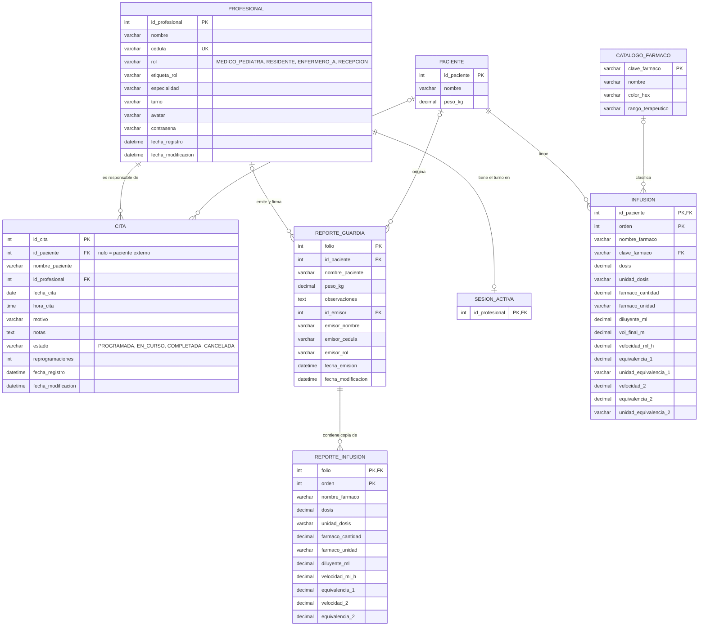

# Diagrama Entidad-Relación y Estructura de Tablas — Aminas PWA

> **Diseño Estructurado Moderno.** Modelo de datos del sistema final (rama `develop`). Cada tabla corresponde a una estructura que la aplicación guarda realmente en `localStorage` y a un almacén del DFD (`D1`…`D7`).
> Actualiza el ER de la primera versión del proyecto: se quitaron los campos que la aplicación no maneja (edad, talla, cama, correo) y se agregaron los que sí existen (rol Recepción, turno, especialidad, reprogramaciones, folio y detalle del snapshot de cada reporte).

---

## 1. Diagrama Entidad-Relación

**Notación de cardinalidad (pata de gallo):** `||` exactamente uno · `|o` cero o uno · `o{` cero o muchos.

---

## 2. Estructura de tablas

Tipos lógicos para una base de datos relacional. Entre paréntesis, la longitud máxima. **PK** = llave primaria · **FK** = llave foránea · **UK** = valor único.

### 2.1 `PROFESIONAL` — Almacén D5 Usuarios (`aminas_usuarios_data`)

| Campo | Tipo | Llave | Nulo | Descripción / validación |
| :--- | :--- | :---: | :---: | :--- |
| id_profesional | INT | PK | No | Consecutivo (mayor id + 1) |
| nombre | VARCHAR(100) | | No | Mínimo 3 caracteres |
| cedula | VARCHAR(20) | UK | No | Mínimo 4 caracteres; no se puede repetir |
| rol | VARCHAR(20) | | No | `MEDICO_PEDIATRA`, `RESIDENTE`, `ENFERMERO_A`, `RECEPCION` |
| etiqueta_rol | VARCHAR(60) | | No | Texto visible del rol |
| especialidad | VARCHAR(100) | | No | Mínimo 3 caracteres |
| turno | VARCHAR(30) | | No | Matutino, Vespertino, Nocturno A, Nocturno B, Jornada Acumulada |
| avatar | VARCHAR(8) | | No | Emoji según el rol |
| contrasena | VARCHAR(60) | | No | Mínimo 3 caracteres |
| fecha_registro | DATETIME | | Sí | Fecha de alta |
| fecha_modificacion | DATETIME | | Sí | Última edición |

### 2.2 `SESION_ACTIVA` — Almacén D6 (`aminas_auth_data`)

| Campo | Tipo | Llave | Nulo | Descripción |
| :--- | :--- | :---: | :---: | :--- |
| id_profesional | INT | PK, FK → PROFESIONAL | No | Profesional en turno (un solo registro). En la app se guarda una copia completa del profesional |

### 2.3 `PACIENTE` — Almacén D1 Pacientes (`aminas_pwa_data.patients`)

| Campo | Tipo | Llave | Nulo | Descripción / validación |
| :--- | :--- | :---: | :---: | :--- |
| id_paciente | INT | PK | No | Consecutivo (`nextPatientId`) |
| nombre | VARCHAR(100) | | No | Por defecto "Paciente {id}" |
| peso_kg | DECIMAL(5,2) | | Sí | ≥ 0; sin peso no se calcula |

Además se guardan dos datos de control del almacén: `activePatientId` (paciente abierto) y `nextPatientId` (siguiente id).

### 2.4 `CATALOGO_FARMACO` — Almacén D3 (constante `medInfo`)

| Campo | Tipo | Llave | Nulo | Descripción |
| :--- | :--- | :---: | :---: | :--- |
| clave_farmaco | VARCHAR(30) | PK | No | Nombre en minúsculas, p. ej. `dopamina` |
| nombre | VARCHAR(50) | | No | Nombre para mostrar |
| color_hex | CHAR(7) | | No | Color pastel `#RRGGBB` |
| rango_terapeutico | VARCHAR(40) | | No | Ej. `2 - 20 mcgr/kg/min` |

Solo lectura: son datos clínicos de referencia (11 claves; "fentanyl" y "fentanilo" son el mismo fármaco).

### 2.5 `INFUSION` — Almacén D2 Infusiones (`aminas_pwa_data.patients[].meds`)

| Campo | Tipo | Llave | Nulo | Descripción / validación |
| :--- | :--- | :---: | :---: | :--- |
| id_paciente | INT | PK, FK → PACIENTE | No | Paciente al que pertenece |
| orden | INT | PK | No | Posición de la fila en la tabla |
| nombre_farmaco | VARCHAR(50) | | Sí | Texto libre |
| clave_farmaco | VARCHAR(30) | FK → CATALOGO_FARMACO | Sí | Solo si el fármaco está en el catálogo |
| dosis | DECIMAL(10,3) | | Sí | ≥ 0 |
| unidad_dosis | VARCHAR(12) | | No | `mcg/kg/min`, `mcg/kg/h`, `mg/kg/h` |
| farmaco_cantidad | DECIMAL(10,3) | | Sí | ≥ 0 |
| farmaco_unidad | VARCHAR(4) | | No | `mg`, `mcg` |
| diluyente_ml | DECIMAL(6,2) | | No | Por defecto 12 |
| vol_final_ml | DECIMAL(6,2) | | No | Calculado = diluyente |
| velocidad_ml_h | DECIMAL(6,2) | | No | Por defecto 1 |
| equivalencia_1 | DECIMAL(10,3) | | Sí | Calculado (a 1 ml/h) |
| unidad_equivalencia_1 | VARCHAR(12) | | No | Igual dominio que `unidad_dosis` |
| velocidad_2 | DECIMAL(6,2) | | No | Por defecto 2 |
| equivalencia_2 | DECIMAL(10,3) | | Sí | Calculado (a velocidad_2) |
| unidad_equivalencia_2 | VARCHAR(12) | | No | Igual dominio que `unidad_dosis` |

### 2.6 `CITA` — Almacén D4 Citas (`aminas_citas_data`)

| Campo | Tipo | Llave | Nulo | Descripción / validación |
| :--- | :--- | :---: | :---: | :--- |
| id_cita | INT | PK | No | Consecutivo |
| id_paciente | INT | FK → PACIENTE | Sí | Nulo = paciente externo |
| nombre_paciente | VARCHAR(100) | | No | Obligatorio (para externos se captura a mano) |
| id_profesional | INT | FK → PROFESIONAL | No | Profesional responsable (no Recepción) |
| fecha_cita | DATE | | No | Obligatoria |
| hora_cita | TIME | | No | Obligatoria |
| motivo | VARCHAR(150) | | No | Obligatorio |
| notas | TEXT | | Sí | Observaciones |
| estado | VARCHAR(12) | | No | `PROGRAMADA`, `EN_CURSO`, `COMPLETADA`, `CANCELADA` |
| reprogramaciones | INT | | No | Por defecto 0 |
| fecha_registro | DATETIME | | Sí | — |
| fecha_modificacion | DATETIME | | Sí | — |

**Regla de no empalme:** no puede haber dos citas con el mismo (`id_profesional`, `fecha_cita`, `hora_cita`) cuyo estado sea `PROGRAMADA` o `EN_CURSO`.

> En la versión offline el profesional se guarda como texto `"Nombre — Especialidad"` (campo `medicoResponsable`). En una base de datos relacional se reemplaza por la llave foránea `id_profesional`.

### 2.7 `REPORTE_GUARDIA` — Almacén D7 Historial (`aminas_historial_data`)

| Campo | Tipo | Llave | Nulo | Descripción |
| :--- | :--- | :---: | :---: | :--- |
| folio | INT | PK | No | Consecutivo |
| id_paciente | INT | FK → PACIENTE | Sí | Referencia informativa: el reporte se conserva aunque el paciente se elimine |
| nombre_paciente | VARCHAR(100) | | No | Copia al momento de emitir |
| peso_kg | DECIMAL(5,2) | | Sí | Copia al momento de emitir |
| observaciones | TEXT | | Sí | Único campo que se puede editar después |
| id_emisor | INT | FK → PROFESIONAL | Sí | Profesional que firmó |
| emisor_nombre, emisor_cedula, emisor_rol | VARCHAR | | Sí | Copia de la firma (no cambia si se edita o elimina al profesional) |
| fecha_emision | DATETIME | | No | — |
| fecha_modificacion | DATETIME | | Sí | Última edición de observaciones |

### 2.8 `REPORTE_INFUSION` — detalle del snapshot (`aminas_historial_data[].infusiones`)

| Campo | Tipo | Llave | Nulo | Descripción |
| :--- | :--- | :---: | :---: | :--- |
| folio | INT | PK, FK → REPORTE_GUARDIA | No | Reporte al que pertenece |
| orden | INT | PK | No | Posición |
| nombre_farmaco … equivalencia_2 | (igual que INFUSION) | | | Copia fija de cada infusión activa al emitir el reporte |

---

## 3. Cardinalidad y reglas de integridad

| Relación | Cardinalidad | Regla |
| :--- | :--- | :--- |
| PACIENTE – INFUSION | 1 : 0..N | Al borrar un paciente se borran sus infusiones (en cascada). Debe existir al menos 1 paciente |
| CATALOGO_FARMACO – INFUSION | 0..1 : 0..N | Una infusión puede ser de un fármaco no catalogado |
| PACIENTE – CITA | 0..1 : 0..N | Las citas de pacientes externos no tienen `id_paciente` |
| PROFESIONAL – CITA | 1 : 0..N | Regla de no empalme por profesional, fecha y hora |
| PACIENTE – REPORTE_GUARDIA | 0..1 : 0..N | El reporte es histórico: no se borra al eliminar al paciente |
| PROFESIONAL – REPORTE_GUARDIA | 0..1 : 0..N | La firma se copia en el reporte |
| REPORTE_GUARDIA – REPORTE_INFUSION | 1 : 0..N | Se borran junto con el reporte |
| PROFESIONAL – SESION_ACTIVA | 1 : 0..1 | Solo un profesional en turno por dispositivo; no se puede dar de baja al que está en turno. Debe existir al menos un Médico Pediatra |

---

## 4. Correspondencia con el almacenamiento real

| Tabla | Almacén DFD | Clave `localStorage` | Clase (diagrama de clases) |
| :--- | :---: | :--- | :--- |
| PACIENTE | D1 | `aminas_pwa_data` → `patients[]` | Paciente |
| INFUSION | D2 | `aminas_pwa_data` → `patients[].meds[]` | Infusion |
| CATALOGO_FARMACO | D3 | (constante en código) | InfoFarmaco |
| CITA | D4 | `aminas_citas_data` | Cita |
| PROFESIONAL | D5 | `aminas_usuarios_data` | Profesional |
| SESION_ACTIVA | D6 | `aminas_auth_data` | (SesionActiva) |
| REPORTE_GUARDIA + REPORTE_INFUSION | D7 | `aminas_historial_data` | RegistroReporte + Emisor + Infusion |

Los datos se guardan como JSON en el navegador (sin servidor). Gracias al patrón Repositorio (`StorageRepository`), estas mismas tablas se pueden llevar a una base de datos relacional (MySQL, PostgreSQL) sin modificar la interfaz ni la lógica de negocio.
