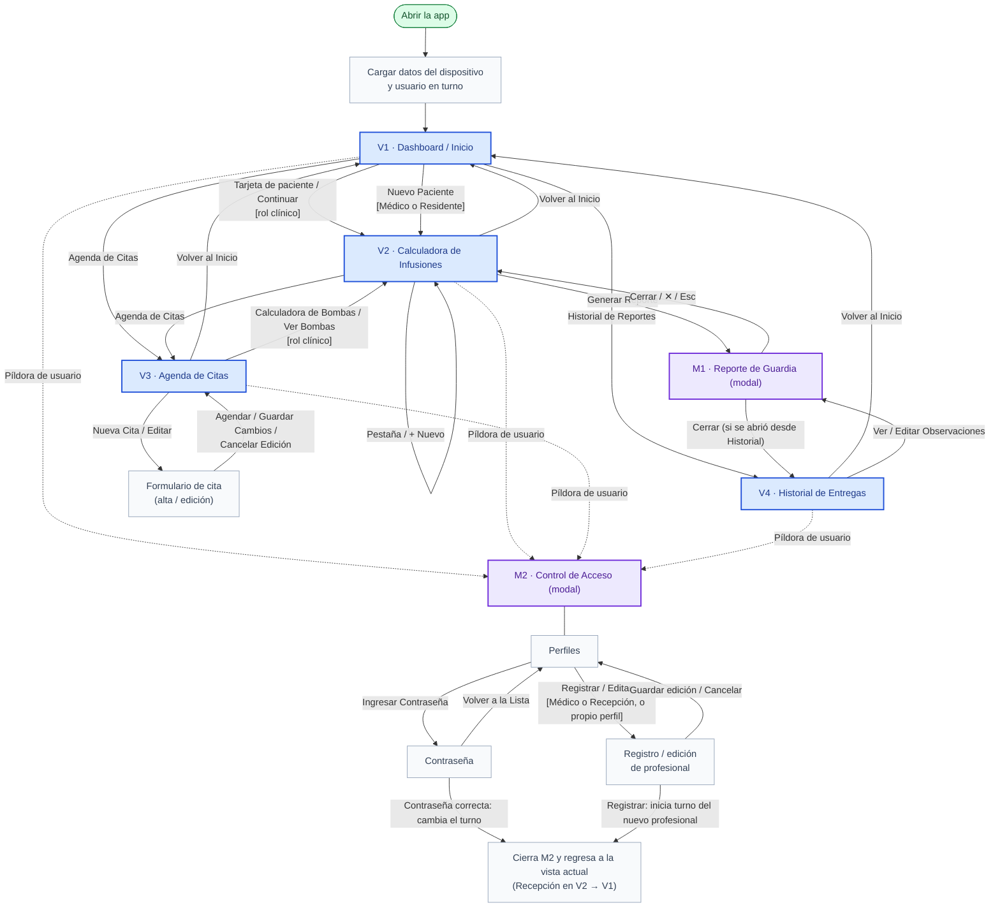

# Diagrama de Navegación de Pantallas — Aminas PWA

> **Diseño Estructurado Moderno · Diseño de pantallas.** Muestra cómo se pasa de una pantalla a otra en la aplicación final (rama `develop`): **4 vistas** principales y **2 ventanas modales**, con el botón que provoca cada cambio y las restricciones por rol.
> Actualiza el diagrama de vistas de la primera versión, que solo tenía Dashboard, Calculadora y Reporte.

---

## 1. Pantallas del sistema

| Código | Pantalla | Tipo | Casos de uso | Quién puede entrar |
| :---: | :--- | :--- | :--- | :--- |
| **V1** | Dashboard / Inicio | Vista | CU02, CU03 | Todos |
| **V2** | Calculadora de Infusiones | Vista | CU03–CU10 | Médico, Residente, Enfermería (**no** Recepción) |
| **V3** | Agenda de Citas (con formulario de alta/edición) | Vista | CU18–CU23 | Todos (los botones cambian según el rol) |
| **V4** | Historial de Entregas de Guardia | Vista | CU15–CU17 | Todos |
| **M1** | Reporte de Guardia / Ficha Médica | Modal | CU11–CU14, CU16 | Médico, Residente, Enfermería |
| **M2** | Control de Acceso (Perfiles · Contraseña · Registro/Edición) | Modal | CU01, CU24–CU26 | Todos (registrar/editar a otros: Médico y Recepción) |

La **barra superior** (marca y píldora del usuario en turno) está visible en todas las vistas; desde ella siempre se abre **M2**.

---

## 2. Diagrama de navegación

**Lectura del diagrama**
- Las cajas azules son **vistas** (ocupan toda la pantalla); las moradas son **modales** (aparecen encima de la vista actual).
- `[condición]` indica que la transición solo existe para ciertos roles. Si el rol no tiene permiso, el botón no aparece; y si se intenta por otra vía, se muestra *"🔒 Acción no permitida"* y se queda en la pantalla actual.
- Al cambiar de turno (M2), todas las vistas se vuelven a dibujar con los permisos del nuevo rol. Si el nuevo rol es **Recepción** y estaba en la Calculadora, regresa a **V1**.
- Los modales M1 y M2 se cierran con **Cerrar**, la **✕**, clic fuera de la ventana o la tecla **Esc**, y regresan a la vista de donde se abrieron.

---

## 3. Acciones de salida desde M1 (Reporte)

| Botón | Resultado | No cambia de pantalla |
| :--- | :--- | :---: |
| 💾 Guardar en Historial / Actualizar Observaciones | Guarda el snapshot o las observaciones y muestra un aviso | ✅ |
| 📋 Copiar para WhatsApp | Copia el resumen al portapapeles | ✅ |
| 🖨️ Imprimir / Guardar PDF | Abre el diálogo de impresión del navegador | ✅ |

---

## 4. Comportamiento responsivo

| Pantalla | Escritorio (> 768 px) | Celular (≤ 768 px) |
| :--- | :--- | :--- |
| V2 Calculadora | Tabla de 11 columnas (con desplazamiento horizontal si no cabe) | Cada infusión se convierte en una **tarjeta** con una etiqueta por campo |
| Barra superior y navegación | Marca y usuario en una línea; botones de navegación en fila | Los elementos se acomodan en varias líneas |
| V1, V3, V4 | Tarjetas en cuadrícula | Las tarjetas se reacomodan al ancho de la pantalla |
| Impresión de M1 | Se oculta la interfaz y queda solo la ficha en hoja blanca | Igual |
