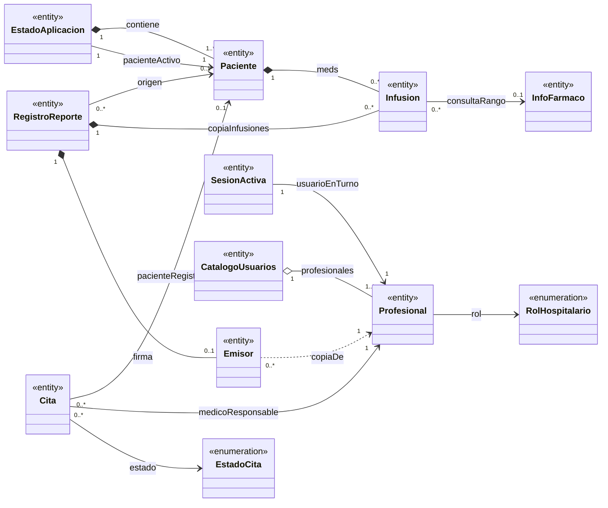
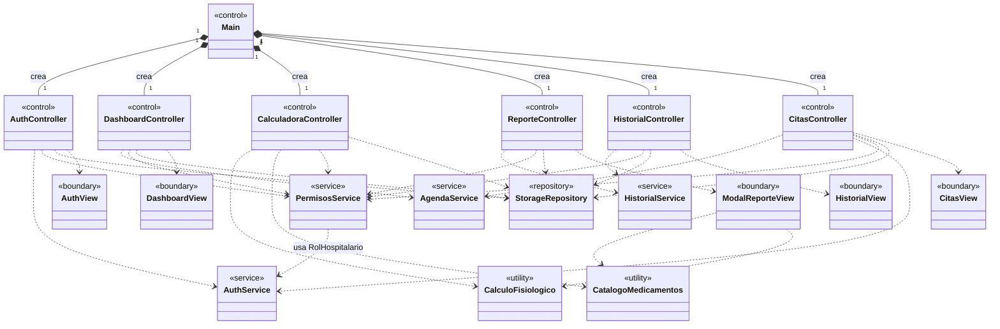

# Diagrama de Relaciones entre Clases — Aminas PWA

> **Análisis Orientado a Objetos.** Muestra **cómo se relacionan** las clases de [`03_diagramas_de_clases.md`](03_diagramas_de_clases.md): tipo de relación, multiplicidad y rol de cada extremo. Para que se lea mejor, aquí las clases aparecen **sin atributos ni métodos**.

---

## 0. Tipos de relación usados

| Relación | Símbolo UML | En Mermaid | Significado | Ejemplo en Aminas |
| :--- | :--- | :--- | :--- | :--- |
| **Composición** | Rombo relleno ◆ | `*--` | El "todo" es dueño de las partes; si se borra el todo, se borran las partes | Al borrar un Paciente se borran sus Infusiones |
| **Agregación** | Rombo vacío ◇ | `o--` | El "todo" agrupa partes que existen por su cuenta | El catálogo de Usuarios agrupa Profesionales |
| **Asociación** | Línea con flecha | `-->` | Un objeto conoce o hace referencia a otro | Una Cita tiene un Profesional responsable |
| **Dependencia** | Flecha punteada | `..>` | Una clase **usa** a otra temporalmente (parámetro, llamada) | CitasController usa AgendaService |
| **Realización / uso de enumeración** | Flecha | `-->` | El atributo toma valores de una enumeración | Cita.estado usa EstadoCita |

**Multiplicidad:** `1` exactamente uno · `0..1` cero o uno · `*` / `0..*` cero o muchos · `1..*` uno o muchos.

> **Sobre la herencia (generalización):** el código **no usa herencia de clases**. Los distintos tipos de usuario (Médico Pediatra, Residente, Enfermero/a, Recepción) son **una sola clase `Profesional`** con el atributo `rol`, y los permisos se resuelven con la matriz de `PermisosService`. Este diseño (rol como dato) permite agregar o cambiar roles sin crear clases nuevas. La generalización entre roles se representa en el **diagrama de jerarquía de actores** (casos de uso), no en el de clases.

---

## 1. Relaciones del modelo de dominio (entidades)

> `CatalogoUsuarios` y `SesionActiva` representan los almacenes **D5 Usuarios** y **D6 Sesión_activa** del DFD: son las colecciones que guardan a los profesionales y al usuario en turno.

| # | Relación | Tipo | Multiplicidad | Justificación en el código |
| :---: | :--- | :--- | :--- | :--- |
| 1 | EstadoAplicacion → Paciente (`contiene`) | Composición | 1 a 1..* | `patients[]` vive dentro de `aminas_pwa_data`; no puede quedar vacío (regla de CU05) |
| 2 | EstadoAplicacion → Paciente (`pacienteActivo`) | Asociación | 1 a 1 | `activePatientId` apunta a un paciente existente |
| 3 | Paciente → Infusion (`meds`) | Composición | 1 a 0..* | Las infusiones se guardan dentro del paciente y se borran con él |
| 4 | Infusion → InfoFarmaco (`consultaRango`) | Asociación | * a 0..1 | `getMedInfo(nombre)` encuentra el fármaco por nombre; si no está catalogado, no hay relación |
| 5 | Cita → Paciente (`pacienteRegistrado`) | Asociación | * a 0..1 | `pacienteId`; vale vacío cuando el paciente es externo |
| 6 | Cita → Profesional (`medicoResponsable`) | Asociación | * a 1 | `medicoResponsable` con el formato "Nombre — Especialidad" |
| 7 | Cita → EstadoCita | Uso de enumeración | — | `estado` ∈ {PROGRAMADA, EN_CURSO, COMPLETADA, CANCELADA} |
| 8 | RegistroReporte → Paciente (`origen`) | Asociación | * a 0..1 | `pacienteId`; el reporte se conserva aunque el paciente se borre |
| 9 | RegistroReporte → Infusion (`copiaInfusiones`) | Composición | 1 a 0..* | Copia profunda (*snapshot*): no cambia si después se modifican las bombas |
| 10 | RegistroReporte → Emisor (`firma`) | Composición | 1 a 0..1 | Datos de firma copiados del usuario en turno |
| 11 | Emisor → Profesional (`copiaDe`) | Dependencia | * a 1 | Se crea a partir del profesional, pero no queda ligado a él |
| 12 | CatalogoUsuarios → Profesional | Agregación | 1 a 1..* | `aminas_usuarios_data`; siempre queda al menos un Médico Pediatra |
| 13 | SesionActiva → Profesional (`usuarioEnTurno`) | Asociación | 1 a 1 | `aminas_auth_data` guarda el profesional en turno |
| 14 | Profesional → RolHospitalario | Uso de enumeración | — | `rol` define los permisos |

---

## 2. Relaciones de diseño (controladores, servicios, persistencia y vistas)

**Colaboración entre controladores (callbacks):** los controladores no se llaman directamente; `Main` les pasa funciones al crearlos. Por ejemplo, `CalculadoraController.onGenerarReporte` → `ReporteController.open()`, `HistorialController.onOpenReporte` → `ReporteController.openFromHistorial()` y `AuthController.onUserChanged` → vuelve a dibujar todas las vistas con los permisos del nuevo rol. Así cada módulo se puede cambiar sin afectar a los otros (**bajo acoplamiento**).

| Regla de diseño | Cómo se cumple |
| :--- | :--- |
| Los controladores **no** escriben en `localStorage` directamente | Siempre pasan por `StorageRepository` (patrón Repositorio) |
| Las reglas de negocio **no** dependen del HTML | Los servicios reciben y devuelven datos; nunca tocan el DOM |
| Las vistas **no** acceden a datos | Solo transforman objetos en HTML |
| El núcleo de cálculo es independiente | `CalculoFisiologico` son funciones puras, sin dependencias |
| Permisos centralizados | Todas las validaciones de rol pasan por `PermisosService.puede()` |
