# Diagramas de Clases Detalladas — Aminas PWA

> **Análisis Orientado a Objetos.** Clases reales del sistema final (rama `develop`, commit `585b050`), con atributos, tipos, visibilidad y métodos tal como están en el código.
> Las relaciones entre clases se detallan en [`06_relaciones_entre_clases.md`](06_relaciones_entre_clases.md).

---

## 0. Notación

| Símbolo | Significado |
| :---: | :--- |
| `+` | Público |
| `-` | Privado / de uso interno de la clase |
| `método()$` | Método **estático** (de clase): se usa sin crear objetos, p. ej. `AgendaService.validarCita()` |
| `<<entity>>` | Clase de **entidad**: datos que se guardan en `localStorage` |
| `<<enumeration>>` | Conjunto fijo de valores |
| `<<service>>` | Clase de **lógica de negocio** (reglas del dominio) |
| `<<utility>>` | Módulo de **funciones puras** (no guarda estado) |
| `<<control>>` | **Controlador**: atiende eventos de la interfaz y coordina servicios |
| `<<repository>>` | Acceso a datos (patrón Repositorio) |
| `<<boundary>>` | **Vista**: genera el HTML que ve el usuario |

**Organización en capas** (ver [`10_arquitectura_en_capas.md`](10_arquitectura_en_capas.md)): Presentación (`js/ui`) → Controladores (`js/controllers`) → Dominio (`js/core`) → Persistencia (`js/data`).

---

## 1. Clases de entidad (modelo de dominio)

Son los objetos que el sistema guarda. En JavaScript se representan como objetos JSON; sus reglas de negocio viven en las clases de servicio (siguiente apartado).

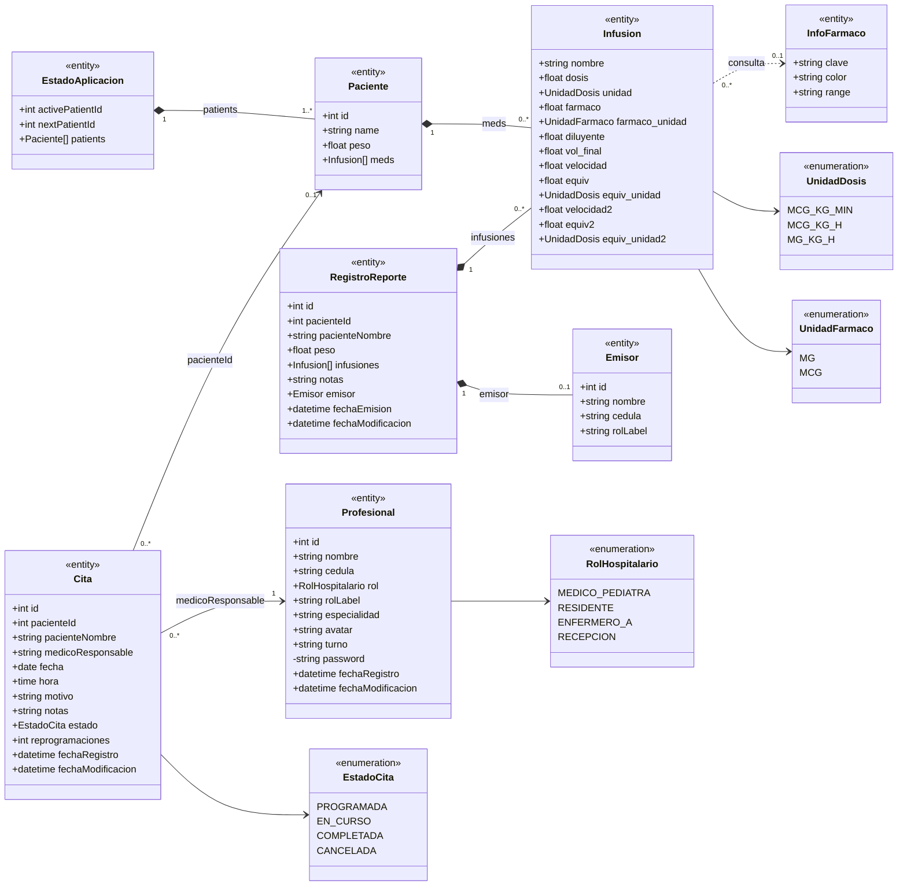

| Clase | Responsabilidad | Dónde se guarda |
| :--- | :--- | :--- |
| **EstadoAplicacion** | Contenedor de todos los pacientes y del paciente activo; genera el siguiente id | `aminas_pwa_data` |
| **Paciente** | Paciente pediátrico con su peso (base de todos los cálculos) | dentro de `EstadoAplicacion.patients` |
| **Infusion** | Línea de fármaco intravenoso: dosis, dilución, velocidad y equivalencias | dentro de `Paciente.meds` |
| **UnidadDosis / UnidadFarmaco** | Valores permitidos: `mcg/kg/min`, `mcg/kg/h`, `mg/kg/h` y `mg`, `mcg` (en el diagrama se escriben como MCG_KG_MIN, etc.) | atributos de Infusion |
| **InfoFarmaco** | Referencia clínica: color pastel y rango terapéutico pediátrico | constante `medInfo` (solo lectura) |
| **Cita** | Cita o control clínico con su ciclo de estados | `aminas_citas_data` |
| **Profesional** | Usuario del sistema con rol, cédula, turno y contraseña | `aminas_usuarios_data` (y el activo en `aminas_auth_data`) |
| **RegistroReporte** | Copia fija (*snapshot*) de una entrega de guardia | `aminas_historial_data` |
| **Emisor** | Datos del profesional que firmó el reporte (sin contraseña) | dentro de `RegistroReporte` |

---

## 2. Clases de servicio (lógica de negocio · `js/core`)

<div class="grid-clases">

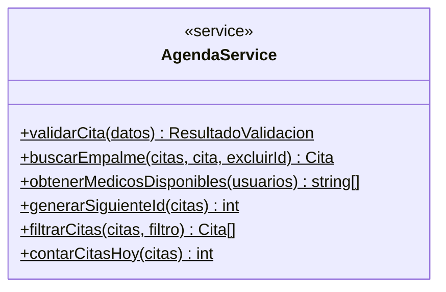

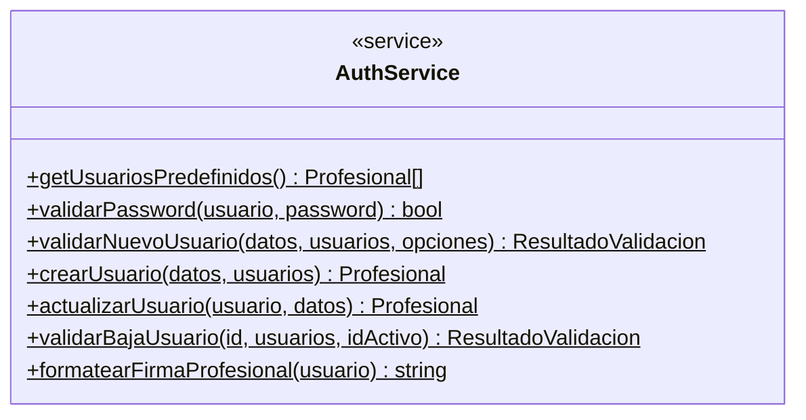

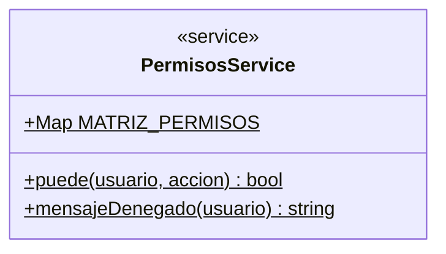

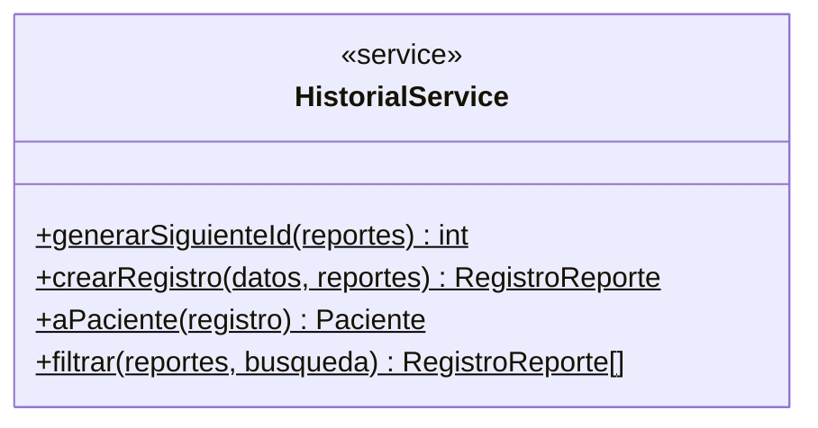

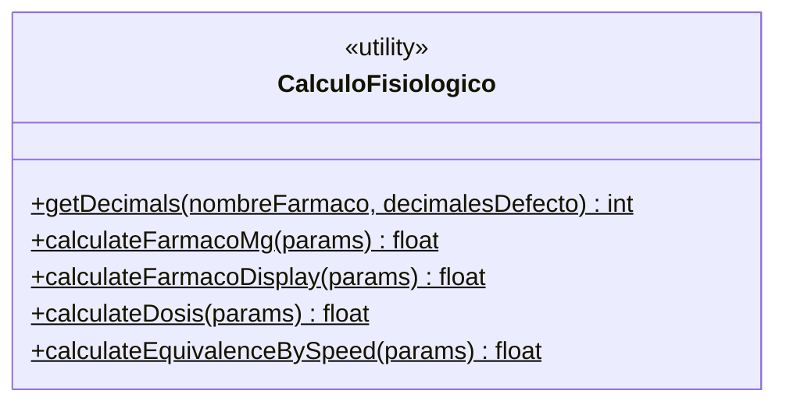

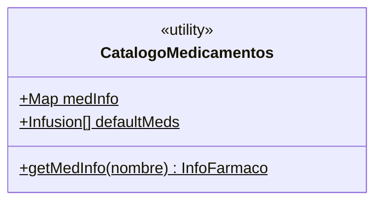

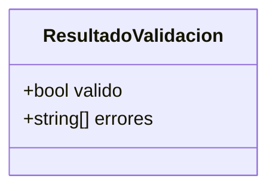

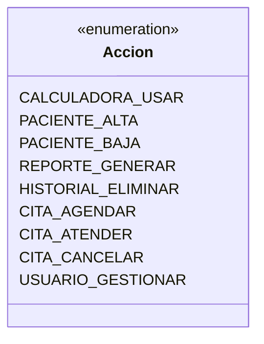

</div>

| Clase | Archivo | Responsabilidad principal |
| :--- | :--- | :--- |
| **AgendaService** | `agendaService.js` | Reglas de citas: campos obligatorios, **no empalme**, filtros, contadores, lista de profesionales |
| **AuthService** | `authService.js` | Reglas de usuarios: contraseña, alta, cambio y baja (cédula única, mínimo 1 Médico Pediatra) |
| **PermisosService** | `permisosService.js` | Matriz de control de acceso por rol (RBAC) |
| **HistorialService** | `historialService.js` | Crea y filtra los snapshots del historial de reportes |
| **CalculoFisiologico** | `calculoFisiologico.js` | **Núcleo matemático**: dosis ↔ fármaco ↔ velocidad, equivalencias y decimales |
| **CatalogoMedicamentos** | `catalogoMedicamentos.js` | Catálogo de fármacos, rangos seguros, colores e infusiones predeterminadas |

---

## 3. Clases de control (`js/controllers` y `js/main.js`)

Cada controlador además guarda referencias a sus elementos HTML (botones, campos); por claridad aquí solo se muestran los atributos de **estado**.

<div class="grid-clases">

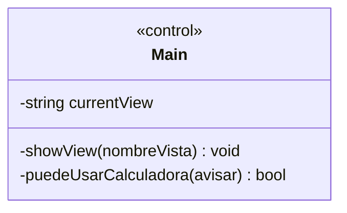

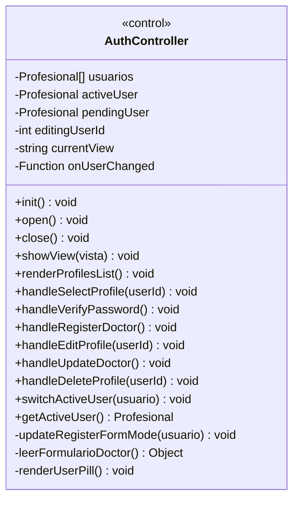

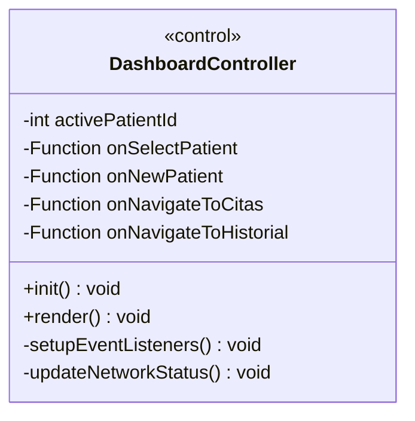

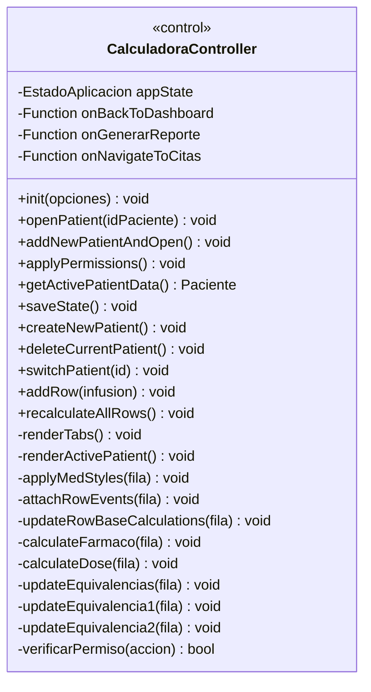

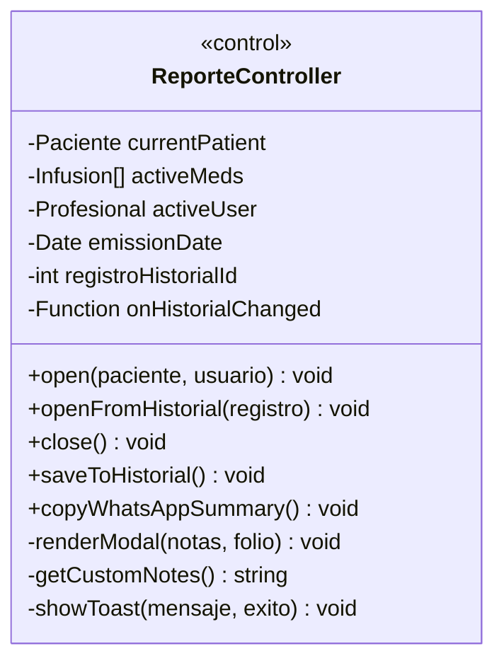

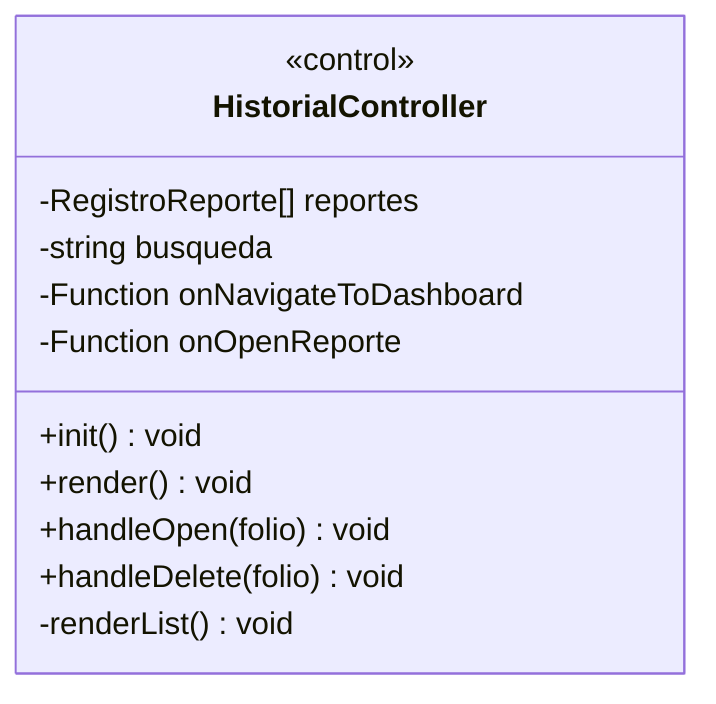

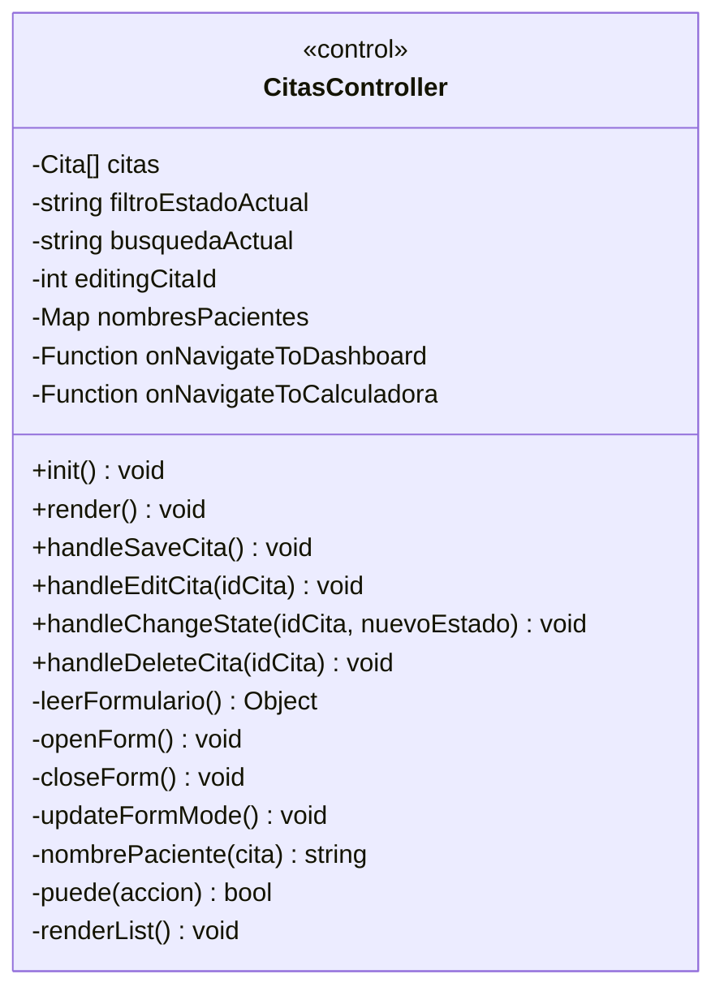

</div>

| Clase | Casos de uso que atiende |
| :--- | :--- |
| **Main** (`main.js`) | Navegación entre vistas y bloqueo de la calculadora por rol |
| **AuthController** | CU01, CU24, CU25, CU26 |
| **DashboardController** | CU02 (y dispara CU03) |
| **CalculadoraController** | CU03 a CU10 |
| **ReporteController** | CU11 a CU14 y CU16 |
| **HistorialController** | CU15 y CU17 |
| **CitasController** | CU18 a CU23 |

---

## 4. Clase de persistencia (`js/data`)

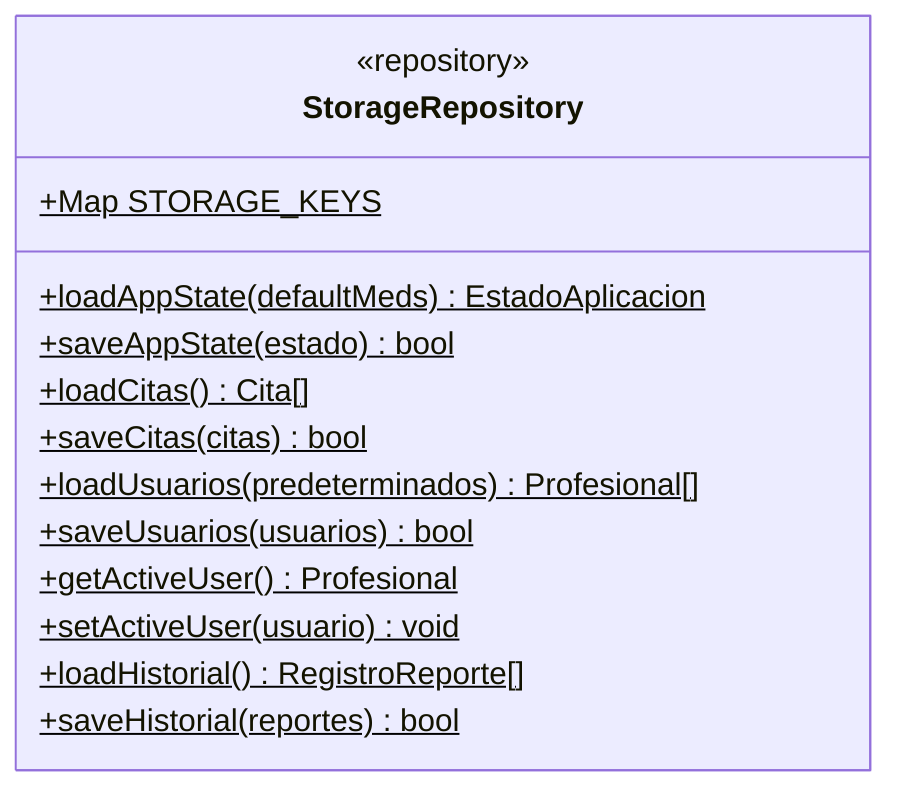

| Clave de `localStorage` | Método de lectura | Método de escritura | Entidad |
| :--- | :--- | :--- | :--- |
| `aminas_pwa_data` | `loadAppState` | `saveAppState` | EstadoAplicacion → Paciente → Infusion |
| `aminas_citas_data` | `loadCitas` | `saveCitas` | Cita |
| `aminas_usuarios_data` | `loadUsuarios` | `saveUsuarios` | Profesional |
| `aminas_auth_data` | `getActiveUser` | `setActiveUser` | Profesional (en turno) |
| `aminas_historial_data` | `loadHistorial` | `saveHistorial` | RegistroReporte |

Todos los métodos de escritura capturan errores (p. ej. almacenamiento lleno) y regresan `false` en lugar de detener la aplicación.

---

## 5. Clases de vista (`js/ui`)

<div class="grid-clases">

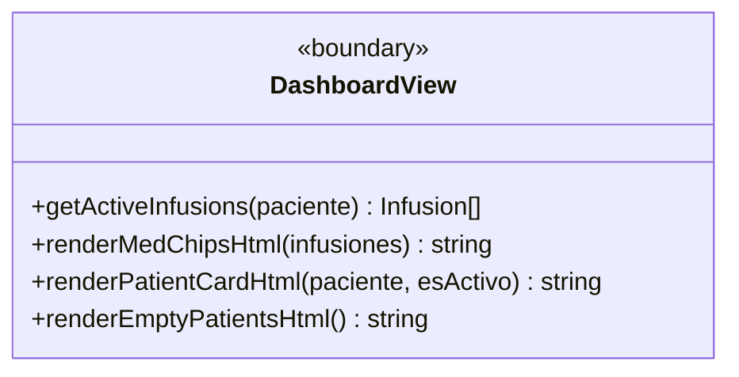

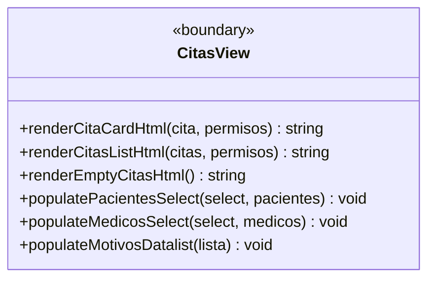

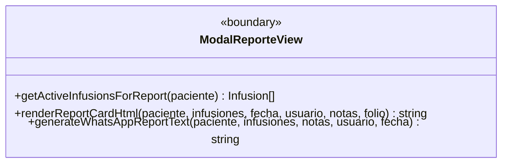

```mermaid
classDiagram
    class HistorialView {
        <<boundary>>
        +renderReporteCardHtml(reporte, opciones) string
        +renderHistorialListHtml(reportes, opciones) string
    }
```

```mermaid
classDiagram
    class AuthView {
        <<boundary>>
        +renderUserPillHtml(usuario) string
        +renderProfilesListHtml(usuarios, idActivo, puedeGestionar) string
        +renderPasswordPromptHtml(usuario) string
    }
```

</div>

Las vistas **no guardan estado ni acceden a los datos**: reciben objetos del controlador y regresan el HTML.
