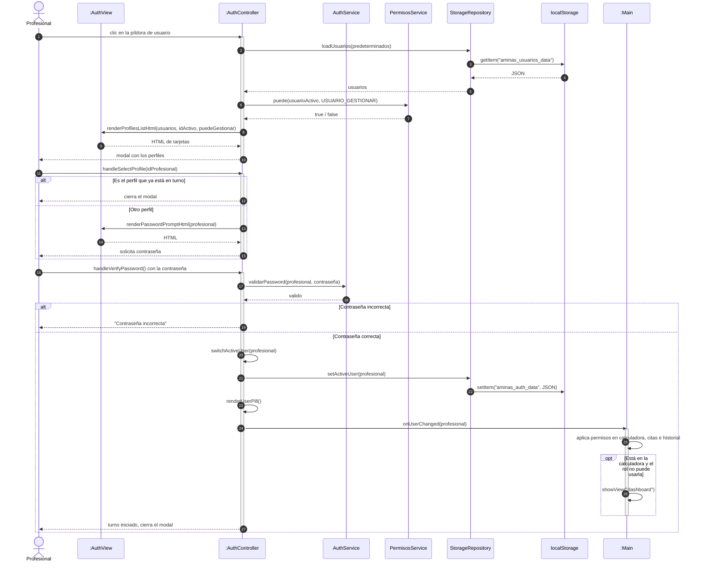
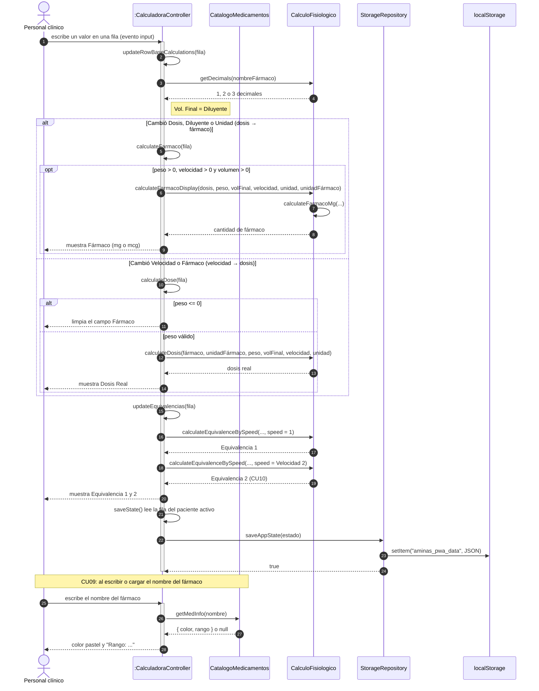
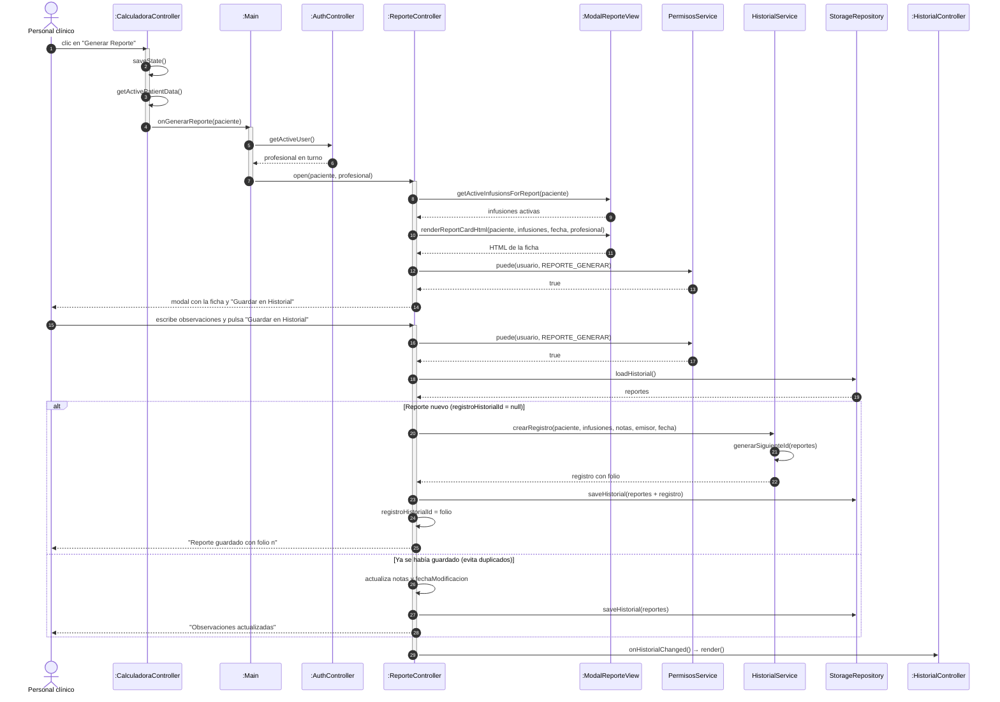
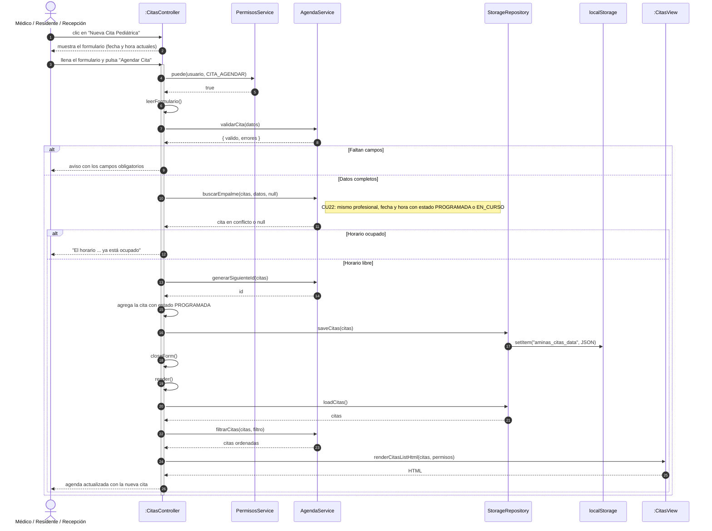
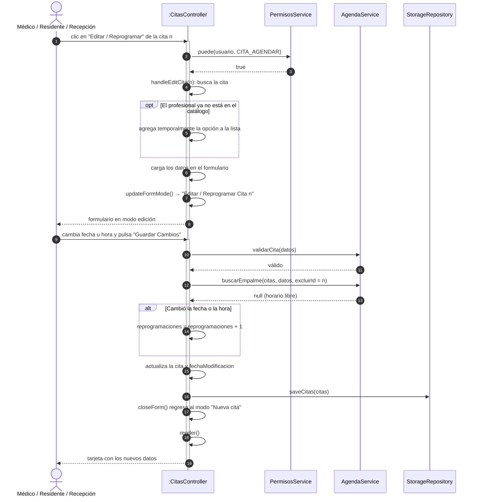
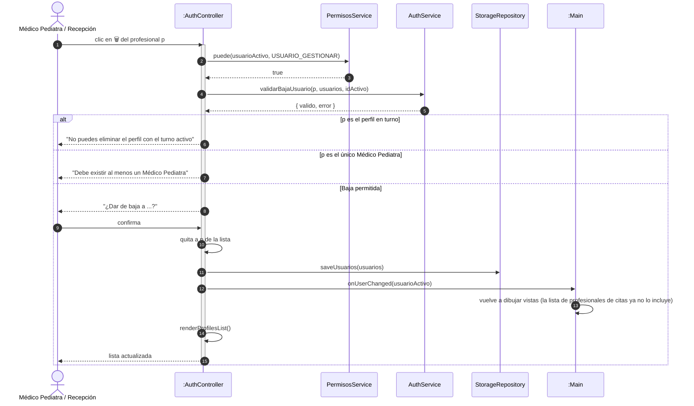

# Diagramas de Secuencia — Aminas PWA

> **Diseño Orientado a Objetos.** Seis diagramas de secuencia (la rúbrica pide mínimo 5) construidos con el código real del sistema final (rama `develop`, commit `585b050`).
> Usan la **numeración de casos de uso** de [`02_casos_de_uso.md`](02_casos_de_uso.md) y las **clases y métodos** de [`03_diagramas_de_clases.md`](03_diagramas_de_clases.md).

| # | Caso de uso | Módulo |
| :---: | :--- | :--- |
| DS-1 | CU01 Iniciar / cambiar turno | Usuarios |
| DS-2 | CU08 Calcular dosis y velocidad (incluye CU09 y CU10) | Infusiones |
| DS-3 | CU11 Generar reporte + CU14 Guardar en historial | Reportes |
| DS-4 | CU18 Agendar cita (incluye CU22 Validar disponibilidad) | Citas |
| DS-5 | CU19 Editar / reprogramar cita | Citas |
| DS-6 | CU26 Dar de baja profesional | Usuarios |

**Notación:** `->>` mensaje (llamada) · `-->>` retorno · `alt/else` alternativa · `opt` opcional · `loop` repetición · las barras de activación indican que el objeto está ejecutando. `localStorage` es el almacenamiento del navegador.

---

## DS-1 · CU01 Iniciar / cambiar turno

**Lectura:** el controlador nunca lee `localStorage` directamente; pasa por `StorageRepository`. La validación de la contraseña es una regla de negocio de `AuthService`. Al cambiar de usuario, `Main` vuelve a aplicar los permisos del nuevo rol en todas las vistas.

---

## DS-2 · CU08 Calcular dosis y velocidad

**Lectura:** el cálculo es **bidireccional** (fragmento `alt`). Todas las fórmulas viven en `CalculoFisiologico` (funciones puras), por lo que el núcleo matemático se puede probar sin la interfaz.

---

## DS-3 · CU11 Generar reporte + CU14 Guardar en historial

**Lectura:** el reporte guardado es una **copia fija** (`crearRegistro` hace una copia profunda de las infusiones), por eso no cambia aunque después se ajusten las bombas.

---

## DS-4 · CU18 Agendar cita (incluye CU22 Validar disponibilidad)

---

## DS-5 · CU19 Editar / reprogramar cita

**Diferencia con DS-4:** `buscarEmpalme` recibe el id de la propia cita (`excluirId`) para que no choque consigo misma.

---

## DS-6 · CU26 Dar de baja profesional

