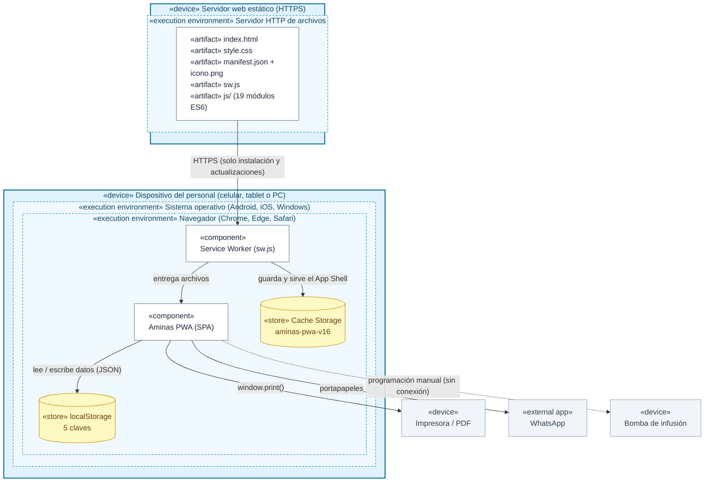

# Diagrama de Distribución (Despliegue) — Aminas PWA

> **Diseño Orientado a Objetos.** Muestra los **nodos físicos** (dispositivos y entornos de ejecución), los **artefactos** (archivos) que se instalan en cada uno y las **conexiones** entre ellos.
> Aminas es una **PWA offline-first**: el servidor solo se usa para descargar e instalar la aplicación; después todo se ejecuta y se guarda en el dispositivo del usuario, sin internet.

---

## 1. Diagrama

---

## 2. Nodos

| Nodo | Tipo | Descripción | Requisitos |
| :--- | :--- | :--- | :--- |
| **Servidor web estático** | «device» | Aloja los archivos de la PWA. No ejecuta lógica ni guarda datos de pacientes. | HTTPS (los Service Workers solo funcionan con HTTPS o `localhost`). Opciones: GitHub Pages, Netlify o el servidor del hospital |
| **Dispositivo del personal** | «device» | Celular, tablet o computadora del área (UCIP, piso, recepción) | Navegador moderno con soporte de Service Worker y `localStorage` |
| **Sistema operativo** | «execution environment» | Permite **instalar** la PWA en la pantalla de inicio (`display: standalone`) | Android, iOS/iPadOS o Windows |
| **Navegador** | «execution environment» | Ejecuta la aplicación, el Service Worker y el almacenamiento local | Chrome, Edge o Safari actualizados |
| **Impresora / PDF** | «device» externo | Recibe el reporte de entrega de guardia | Cualquiera configurada en el sistema operativo |
| **WhatsApp** | «external app» | Recibe el resumen pegado desde el portapapeles | Instalado en el dispositivo o en WhatsApp Web |
| **Bomba de infusión** | «device» externo | No tiene conexión con el sistema; el usuario transcribe la velocidad | — |

## 3. Artefactos y componentes

| Artefacto / componente | Ubicación | Descripción |
| :--- | :--- | :--- |
| `index.html`, `style.css` | Servidor → caché del navegador | Estructura y estilos de las 4 vistas y los 2 modales |
| `manifest.json`, `icono.png` | Servidor → caché | Permite instalar la app con nombre, ícono y color |
| `sw.js` | Servidor → navegador | **Service Worker**: al instalarse guarda 24 archivos en *Cache Storage* y después los sirve **sin internet** (estrategia *cache first*) |
| `js/` (19 módulos ES6) | Servidor → caché | Capas de controladores, dominio, datos y vistas |
| **Cache Storage** `aminas-pwa-v16` | Navegador | Copia local del *App Shell*; al publicar una versión nueva se cambia el número y se borra la anterior |
| **localStorage** | Navegador | Datos del sistema: `aminas_pwa_data`, `aminas_citas_data`, `aminas_usuarios_data`, `aminas_auth_data`, `aminas_historial_data` |

## 4. Conexiones

| Conexión | Protocolo / mecanismo | Cuándo ocurre |
| :--- | :--- | :--- |
| Servidor → Navegador | HTTPS | Primera instalación y cuando hay versión nueva. **No** se envían datos de pacientes al servidor |
| Aplicación ↔ localStorage | API Web Storage (JSON) | En cada cambio (guardado automático) |
| Service Worker ↔ Cache Storage | Cache API | Instalación (`install`), cada petición (`fetch`) y limpieza de versiones (`activate`) |
| Aplicación → Impresora | `window.print()` + estilos `@media print` | Al imprimir o guardar el reporte en PDF |
| Aplicación → WhatsApp | Portapapeles (`navigator.clipboard`) | Al copiar el resumen de guardia |
| Usuario → Bomba de infusión | Manual | Al programar la velocidad calculada |

---

## 5. Consideraciones del despliegue

1. **Funcionamiento sin internet:** después de la primera carga, la aplicación abre y opera completamente offline.
2. **Privacidad:** los datos clínicos **nunca salen del dispositivo**; no hay base de datos en servidor.
3. **Datos por dispositivo:** cada equipo tiene su propia información (no hay sincronización entre dispositivos). La arquitectura con `StorageRepository` permite agregar después un backend con sincronización sin cambiar las demás capas.
4. **Actualizaciones:** se publica en el servidor y se incrementa la versión de caché en `sw.js` (`aminas-pwa-v16` → `v17`).
5. **Estado actual del proyecto:** el repositorio no tiene GitHub Pages activado. Para la revisión en laboratorio la app se sirve desde un servidor local (`http://localhost`), que el navegador acepta igual que HTTPS para el Service Worker. Para dejarla instalable en celulares se recomienda activar **GitHub Pages** en la rama principal.
