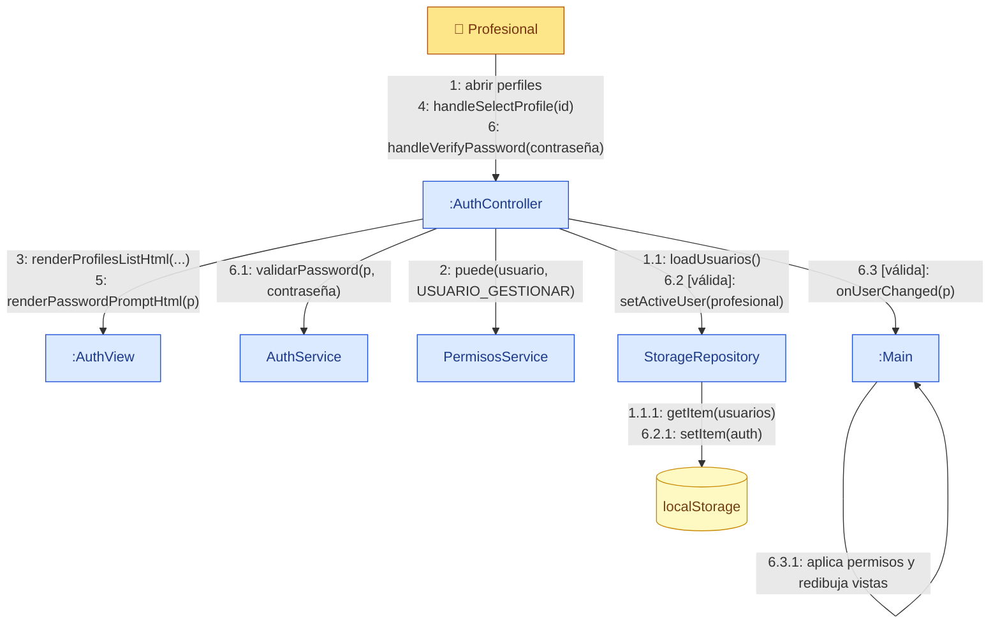
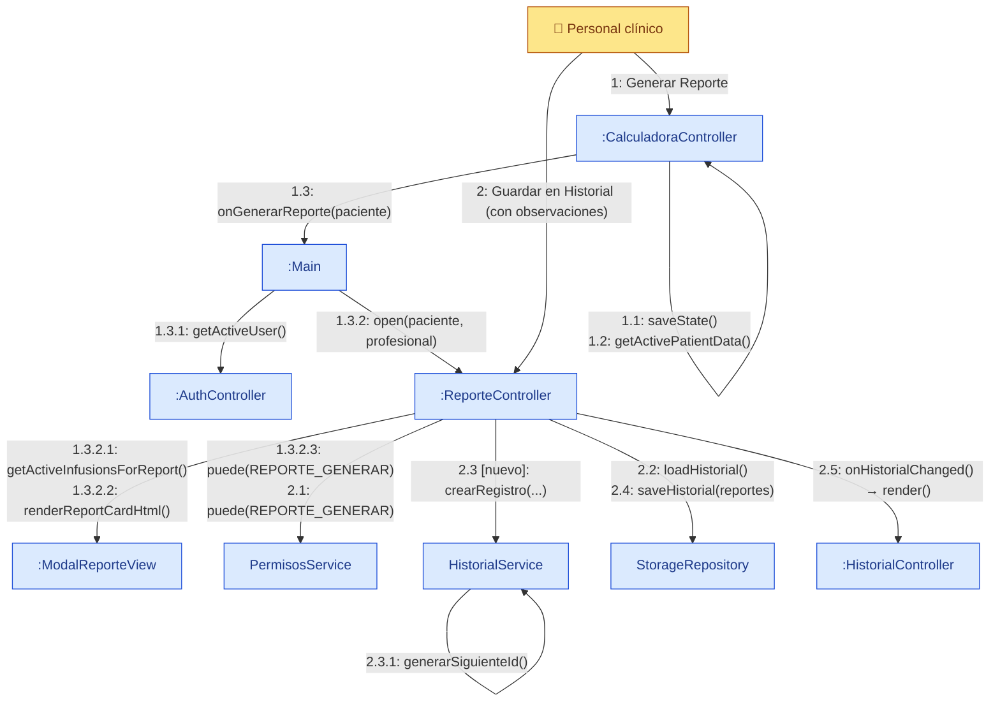
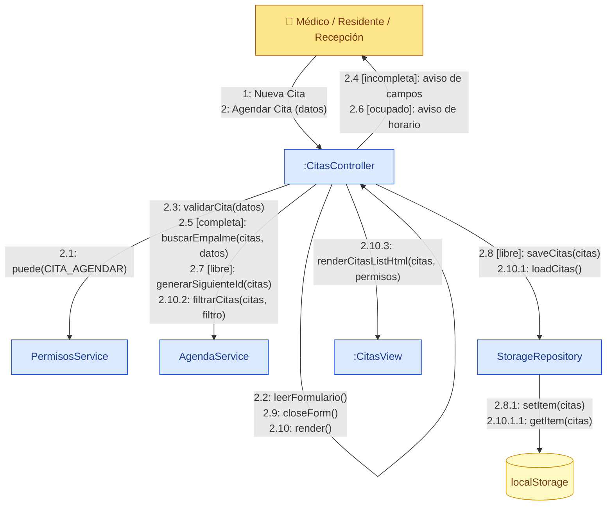

# Diagramas de Colaboración (Comunicación) — Aminas PWA

> **Diseño Orientado a Objetos.** Tres diagramas de colaboración (mínimo pedido: 3). Muestran **qué objetos se comunican** y **en qué orden**, poniendo los mensajes numerados sobre los enlaces.
> Cada uno es **equivalente** a un diagrama de secuencia de [`07_diagramas_de_secuencia.md`](07_diagramas_de_secuencia.md): mismos objetos, mismos mensajes y misma numeración.

| Diagrama | Caso de uso | Secuencia equivalente |
| :---: | :--- | :---: |
| DC-1 | CU01 Iniciar / cambiar turno | DS-1 |
| DC-2 | CU11 + CU14 Generar reporte y guardar en historial | DS-3 |
| DC-3 | CU18 Agendar cita (incluye CU22) | DS-4 |

**Cómo leerlos**
- Cada caja es un **objeto** (`:Clase`) o una clase con métodos estáticos (`Clase`).
- Cada línea es un **enlace** (los objetos se conocen o se llaman).
- Sobre el enlace van los mensajes con su **número de orden**: `1`, `2`, `3`… Los números con punto (`3.1`, `3.2`) son mensajes **anidados** que ocurren mientras se atiende el mensaje 3.
- `[condición]` = el mensaje solo se envía si se cumple la condición. `*` = se repite.

---

## DC-1 · CU01 Iniciar / cambiar turno

| # | Mensaje | De → A | Propósito |
| :---: | :--- | :--- | :--- |
| 1 | abrir perfiles | Profesional → AuthController | Clic en la píldora de usuario |
| 1.1 | `loadUsuarios()` | AuthController → StorageRepository | Leer el catálogo de profesionales |
| 2 | `puede(usuario, USUARIO_GESTIONAR)` | AuthController → PermisosService | Decidir si se muestran Editar/Eliminar |
| 3 | `renderProfilesListHtml()` | AuthController → AuthView | Dibujar las tarjetas |
| 4–5 | `handleSelectProfile()` / `renderPasswordPromptHtml()` | — | Elegir perfil y pedir contraseña |
| 6.1 | `validarPassword()` | AuthController → AuthService | Regla de negocio |
| 6.2 | `setActiveUser()` | AuthController → StorageRepository | Guardar la sesión (solo si es válida) |
| 6.3 | `onUserChanged()` | AuthController → Main | Reaplicar permisos del nuevo rol |

---

## DC-2 · CU11 + CU14 Generar reporte y guardar en historial

| # | Mensaje | Propósito |
| :---: | :--- | :--- |
| 1–1.2 | `saveState()`, `getActivePatientData()` | Guardar y obtener los datos actuales del paciente |
| 1.3 | `onGenerarReporte(paciente)` | La calculadora avisa a `Main` (no conoce al ReporteController) |
| 1.3.1–1.3.2 | `getActiveUser()`, `open()` | Obtener al firmante y abrir el modal |
| 1.3.2.1–1.3.2.3 | Filtrar infusiones activas, dibujar ficha, verificar permiso | Armar la ficha |
| 2.1–2.4 | Verificar permiso, leer historial, crear snapshot con folio y guardar | CU14 |
| 2.5 | `onHistorialChanged()` | Actualizar la vista de historial |

---

## DC-3 · CU18 Agendar cita (incluye CU22)

| # | Mensaje | Propósito |
| :---: | :--- | :--- |
| 2.1 | `puede(CITA_AGENDAR)` | Control de acceso por rol |
| 2.2 | `leerFormulario()` | Tomar los datos capturados |
| 2.3 | `validarCita()` | Campos obligatorios |
| 2.4 | aviso `[incompleta]` | Si falta un dato termina aquí |
| 2.5 | `buscarEmpalme()` | **CU22**: no empalme por profesional, fecha y hora |
| 2.6 | aviso `[ocupado]` | Si el horario está ocupado termina aquí |
| 2.7–2.8 | `generarSiguienteId()`, `saveCitas()` | Alta de la cita como PROGRAMADA |
| 2.9–2.10.3 | Cerrar formulario y redibujar la agenda | Mostrar la cita nueva |

---

## Diferencia entre secuencia y colaboración

| Diagrama de secuencia | Diagrama de colaboración |
| :--- | :--- |
| Enfatiza el **orden en el tiempo** (eje vertical) | Enfatiza la **estructura**: qué objetos están enlazados |
| Muestra activaciones y fragmentos `alt/opt/loop` | Muestra condiciones `[ ]` y numeración anidada |
| Útil para ver el flujo completo de un caso de uso | Útil para ver el acoplamiento entre objetos |
