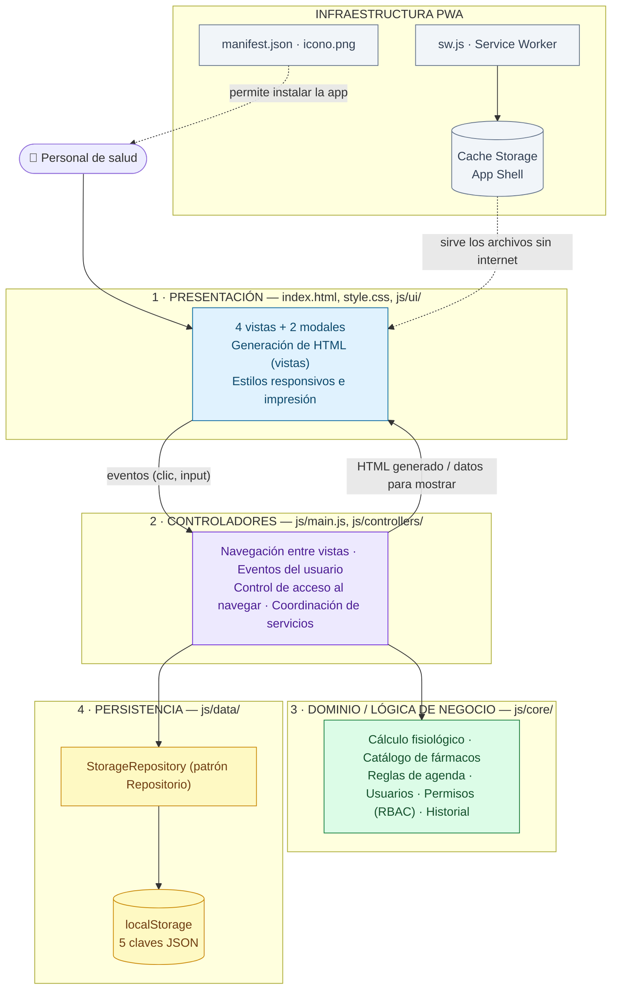
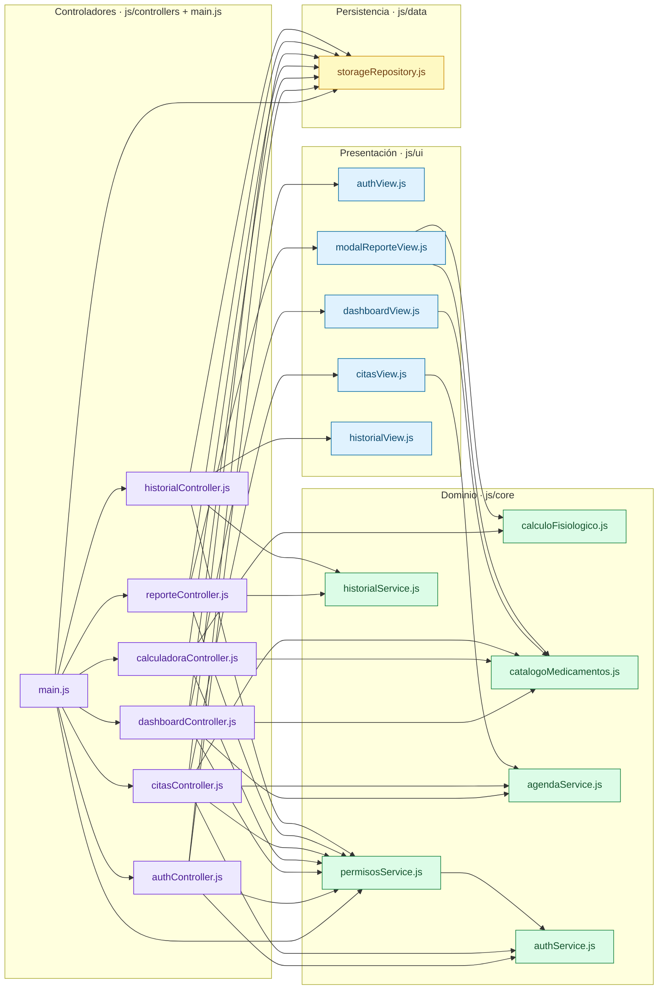

# Diagrama de Arquitectura en Capas — Aminas PWA

> **Diseño del sistema.** Organización real del código de la versión final (rama `develop`): 4 capas más la infraestructura PWA. Las flechas del diagrama 2 se obtuvieron de los `import` de cada archivo, así que representan exactamente las dependencias del código.
> Actualiza el diagrama de arquitectura de la primera versión, que incluía componentes planeados que no se construyeron (por ejemplo, un adaptador de API simulada).

---

## 1. Vista general de las capas

**Regla de dependencia:** cada capa solo usa a las capas de abajo. El dominio (capa 3) **no** conoce la interfaz ni el almacenamiento: recibe datos y regresa resultados. Por eso el núcleo de cálculo se puede probar o reutilizar por separado.

---

## 2. Módulos y dependencias reales

---

## 3. Responsabilidad de cada capa

| Capa | Archivos | Responsabilidad | Qué **no** hace |
| :--- | :--- | :--- | :--- |
| **1. Presentación** | `index.html`, `style.css`, `js/ui/authView.js`, `dashboardView.js`, `citasView.js`, `modalReporteView.js`, `historialView.js` | Estructura de las pantallas, estilos responsivos y de impresión, y funciones que convierten datos en HTML | No guarda datos ni aplica reglas de negocio |
| **2. Controladores** | `js/main.js`, `js/controllers/authController.js`, `dashboardController.js`, `calculadoraController.js`, `citasController.js`, `reporteController.js`, `historialController.js` | Escuchan eventos, leen formularios, llaman a servicios y al repositorio, y cambian de vista. `main.js` crea los controladores y los conecta con funciones (*callbacks*) | No contienen fórmulas ni acceden directo a `localStorage` |
| **3. Dominio** | `js/core/calculoFisiologico.js`, `catalogoMedicamentos.js`, `agendaService.js`, `authService.js`, `permisosService.js`, `historialService.js` | Fórmulas de infusión, catálogo y rangos, reglas de citas (no empalme), usuarios, matriz de permisos e historial | No toca el HTML ni el almacenamiento |
| **4. Persistencia** | `js/data/storageRepository.js` | Lee y escribe las 5 claves de `localStorage`, con datos por defecto y manejo de errores | No decide reglas de negocio |
| **Infraestructura PWA** | `sw.js`, `manifest.json`, `icono.png` | Caché offline (24 archivos, versión `aminas-pwa-v16`) e instalación en el dispositivo | — |

---

## 4. Beneficios de esta arquitectura

1. **Separación de responsabilidades:** cada archivo tiene una sola función clara; un cambio de diseño visual no afecta las fórmulas.
2. **Núcleo de cálculo protegido:** `calculoFisiologico.js` son funciones puras sin dependencias; ningún otro módulo modifica las fórmulas.
3. **Permisos centralizados:** todas las reglas de acceso están en `permisosService.js`; agregar un rol solo requiere cambiar la matriz.
4. **Persistencia reemplazable:** como todo pasa por `StorageRepository`, se puede cambiar `localStorage` por una base de datos o un servidor sin tocar las otras capas.
5. **Offline real:** el Service Worker sirve la aplicación desde caché, así que funciona sin internet en áreas hospitalarias sin señal.
