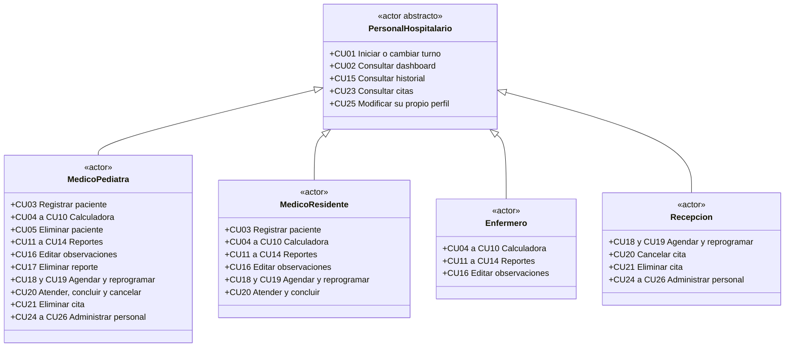

# Lista de Actores y Diagrama de Jerarquía de Usuarios — Aminas PWA

> **Análisis Orientado a Objetos.** Actores que interactúan con el sistema y su **generalización**: los roles especializados heredan lo que puede hacer el actor base. Los permisos corresponden a la matriz de `js/core/permisosService.js` y los casos de uso a la numeración oficial (CU01–CU26).

---

## 1. Lista de actores

| Actor | Tipo | Rol en el sistema (`rol`) | Descripción | Responsabilidades principales |
| :--- | :--- | :--- | :--- | :--- |
| **Personal Hospitalario** | Abstracto (generalización) | — | Cualquier profesional registrado | Iniciar turno, ver dashboard, consultar citas e historial, editar su propio perfil |
| **Médico Pediatra** | Principal | `MEDICO_PEDIATRA` | Médico especialista o intensivista; máxima autoridad clínica | Todo lo clínico, más baja de pacientes y reportes, y administración del personal |
| **Médico Residente** | Principal | `RESIDENTE` | Médico en formación de la especialidad | Calculadora, alta de pacientes, reportes, agendar y atender citas |
| **Enfermero/a** | Principal | `ENFERMERO_A` | Enfermería especialista de UCIP o piso | Registrar peso, ajustar bombas, generar y guardar reportes de entrega de guardia |
| **Administrador / Recepción** | Principal | `RECEPCION` | Personal administrativo y de admisión | Agendar, reprogramar, cancelar y eliminar citas; administrar al personal. **No** usa la calculadora |
| **Bomba de infusión** | Secundario (pasivo) | — | Dispositivo médico | Recibe manualmente la velocidad calculada |

**Usuarios de demostración** (contraseña `1234`): Dr. Alejandro Morales y Dra. Sofía Herrera (Médico Pediatra), Dra. Andrea Ruiz (Residente), Enf. Esp. Laura Valenzuela (Enfermería) y Lic. Mariana Torres (Recepción).

---

## 2. Diagrama de jerarquía de usuarios

**Lectura:** la flecha con triángulo es la **generalización UML**. Cada rol hereda los casos de uso del Personal Hospitalario (arriba) y agrega los suyos. En el código, la jerarquía se implementa con el atributo `rol` del profesional y la matriz de permisos, no con subclases.

---

## 3. Matriz de permisos por rol

✅ permitido · ❌ no permitido

| Acción (`ACCIONES`) | Casos de uso | Médico Pediatra | Residente | Enfermería | Recepción |
| :--- | :--- | :---: | :---: | :---: | :---: |
| Usar la calculadora (`CALCULADORA_USAR`) | CU04, CU06–CU10 | ✅ | ✅ | ✅ | ❌ |
| Registrar paciente (`PACIENTE_ALTA`) | CU03 | ✅ | ✅ | ❌ | ❌ |
| Eliminar paciente (`PACIENTE_BAJA`) | CU05 | ✅ | ❌ | ❌ | ❌ |
| Generar y guardar reportes (`REPORTE_GENERAR`) | CU11–CU14, CU16 | ✅ | ✅ | ✅ | ❌ |
| Eliminar reportes del historial (`HISTORIAL_ELIMINAR`) | CU17 | ✅ | ❌ | ❌ | ❌ |
| Agendar y editar citas (`CITA_AGENDAR`) | CU18, CU19 | ✅ | ✅ | ❌ | ✅ |
| Atender y concluir citas (`CITA_ATENDER`) | CU20 | ✅ | ✅ | ❌ | ❌ |
| Cancelar y eliminar citas (`CITA_CANCELAR`) | CU20, CU21 | ✅ | ❌ | ❌ | ✅ |
| Administrar al personal (`USUARIO_GESTIONAR`) | CU24–CU26 | ✅ | ❌ | ❌ | ✅ |
| Iniciar turno, ver dashboard, citas e historial, editar su perfil | CU01, CU02, CU15, CU23, CU25 | ✅ | ✅ | ✅ | ✅ |
