# Manual de Usuario — Aminas PWA

> Guía para el personal de salud y de recepción. Explica cómo instalar la aplicación y cómo usar cada módulo paso a paso.

---

## 1. ¿Qué es Aminas PWA?

Aminas PWA es una aplicación para **calcular infusiones continuas pediátricas** (dosis, velocidad de bomba y preparación del fármaco) y para organizar el servicio: pacientes, agenda de citas, reportes de entrega de guardia e historial. Funciona en celular, tableta o computadora y **trabaja sin internet** después de la primera carga.

> ⚠️ **Importante:** Aminas es una herramienta de apoyo. Verifica siempre los cálculos antes de programar la bomba, según los protocolos de tu institución.

---

## 2. Requisitos e instalación

**Requisitos:** navegador actualizado (Chrome, Edge o Safari) y conexión a internet **solo la primera vez**.

**Instalar en el celular**
1. Abre la dirección de la aplicación en el navegador.
2. **Android (Chrome):** menú ⋮ → *Agregar a la pantalla principal* / *Instalar aplicación*.
   **iPhone (Safari):** botón Compartir → *Agregar a pantalla de inicio*.
3. Abre Aminas desde el ícono nuevo. A partir de ahora funciona aunque no haya señal.

**En computadora:** abre la dirección en Chrome o Edge y, si quieres, usa el ícono *Instalar* de la barra de direcciones.

La insignia **🟢 Modo Offline Listo** indica que la app está lista para trabajar sin internet; **🟡 Sin Conexión (Offline)** indica que no hay red, pero puedes seguir trabajando normalmente.

---

## 3. Iniciar o cambiar de turno

Todo lo que hagas queda a nombre del **profesional en turno** (su nombre firma los reportes) y lo que puedes hacer depende de su **rol**.

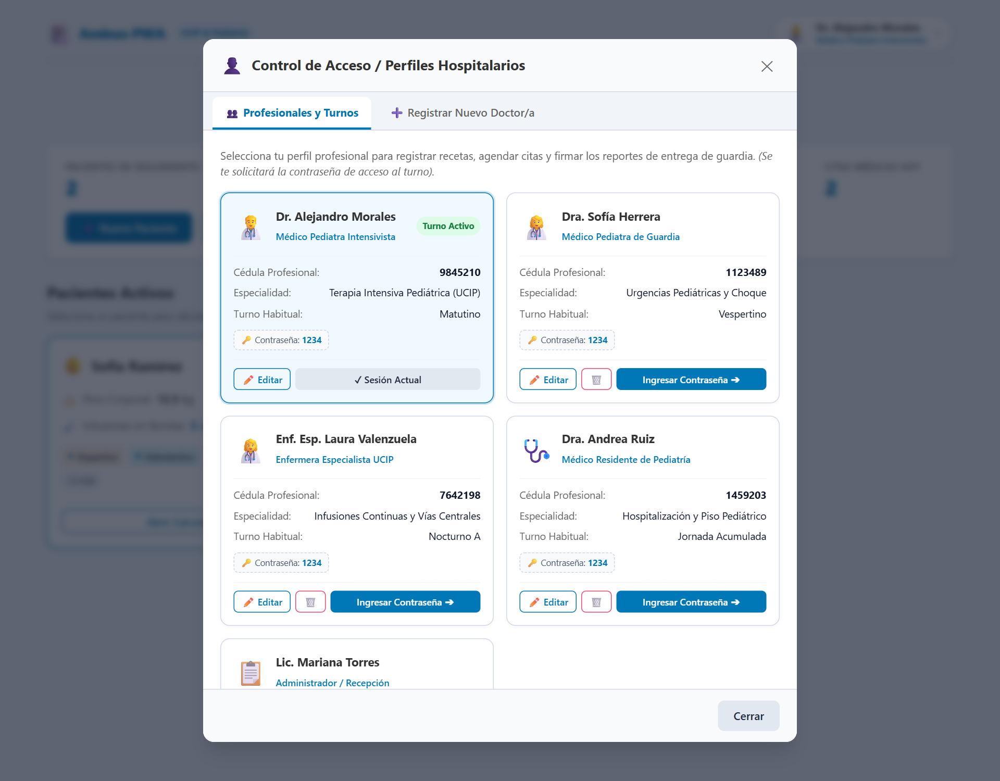

1. Toca la **píldora con tu nombre** (arriba a la derecha).
2. En **Profesionales y Turnos**, busca tu tarjeta y toca **Ingresar Contraseña ➔**.
3. Escribe tu contraseña y toca **🔑 Validar e Iniciar Turno**.

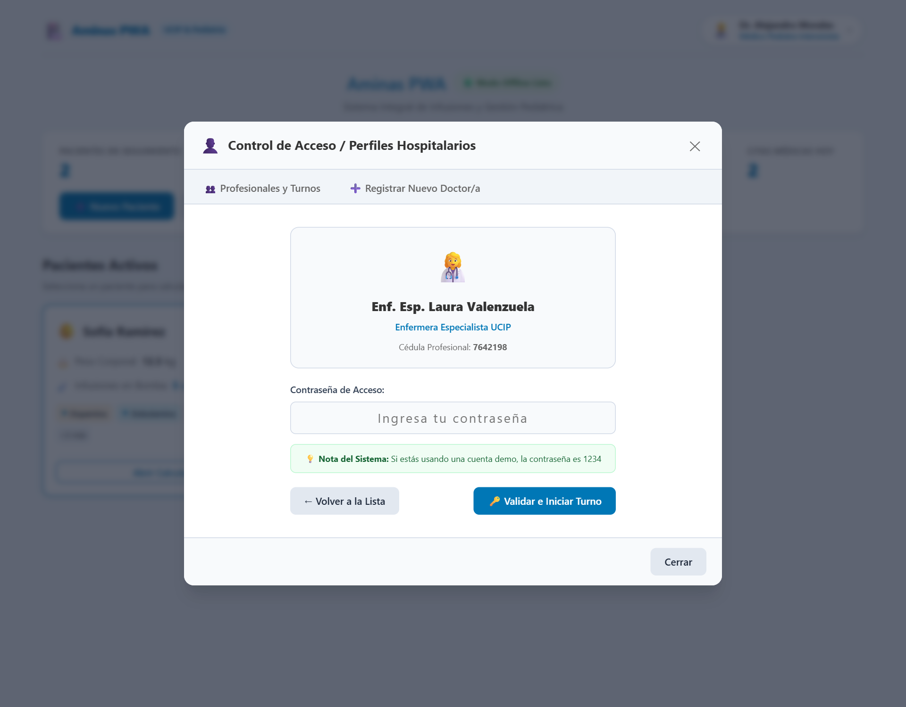

Si la contraseña es incorrecta aparece *"❌ Contraseña incorrecta"*. Toca **← Volver a la Lista** para elegir otro perfil.

**Cuentas de demostración** (contraseña `1234`):

| Profesional | Rol |
| :--- | :--- |
| Dr. Alejandro Morales | Médico Pediatra |
| Dra. Sofía Herrera | Médico Pediatra |
| Dra. Andrea Ruiz | Médico Residente |
| Enf. Esp. Laura Valenzuela | Enfermería |
| Lic. Mariana Torres | Administrador / Recepción |

### ¿Qué puede hacer cada rol?

| Función | Médico Pediatra | Residente | Enfermería | Recepción |
| :--- | :---: | :---: | :---: | :---: |
| Calculadora (peso, bombas, cálculos) | ✅ | ✅ | ✅ | ❌ |
| Registrar paciente | ✅ | ✅ | ❌ | ❌ |
| Eliminar paciente | ✅ | ❌ | ❌ | ❌ |
| Generar y guardar reportes | ✅ | ✅ | ✅ | ❌ |
| Eliminar reportes del historial | ✅ | ❌ | ❌ | ❌ |
| Agendar y editar citas | ✅ | ✅ | ❌ | ✅ |
| Atender y concluir citas | ✅ | ✅ | ❌ | ❌ |
| Cancelar y eliminar citas | ✅ | ❌ | ❌ | ✅ |
| Administrar al personal | ✅ | ❌ | ❌ | ✅ |

Si tu rol no tiene permiso, el botón simplemente **no aparece**.

---

## 4. Pantalla de inicio (Dashboard)

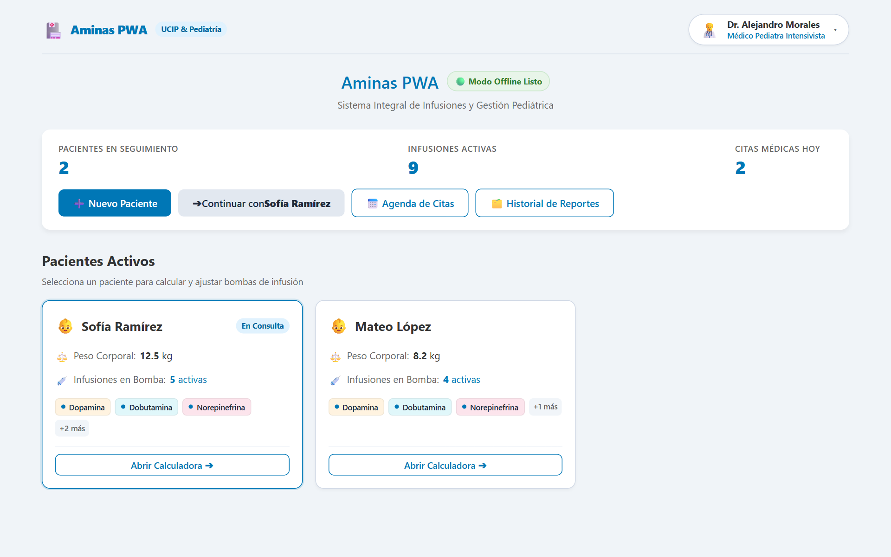

- **Indicadores:** pacientes en seguimiento, infusiones activas y citas de hoy.
- **➕ Nuevo Paciente:** crea un paciente y abre la calculadora.
- **➔ Continuar con {paciente}:** abre al último paciente que usaste.
- **📅 Agenda de Citas** y **🗂️ Historial de Reportes:** abren esos módulos.
- **Tarjetas de pacientes:** muestran peso e infusiones activas; tócala para abrir su calculadora.

---

## 5. Calculadora de infusiones

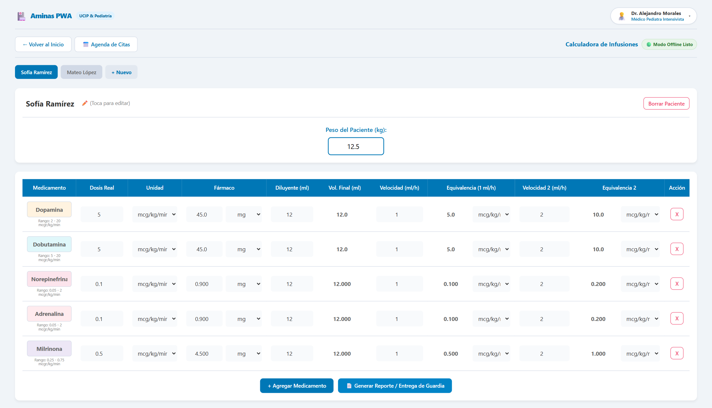

### 5.1 Preparar al paciente
1. Usa las **pestañas** de arriba para cambiar de paciente, o **+ Nuevo** para agregar uno.
2. Toca el **nombre** del paciente para renombrarlo y presiona *Enter*.
3. Escribe el **Peso del Paciente (kg)**. **Sin peso no se calcula nada.**

Cada paciente nuevo trae 9 medicamentos preconfigurados (Dopamina, Dobutamina, Norepinefrina, Adrenalina, Milrinona, Midazolam, Fentanyl, Dexmedetomidina y Propofol). Puedes quitar los que no uses con **X** y agregar otros con **+ Agregar Medicamento**.

### 5.2 Calcular: dos formas

**A) Conozco la dosis que quiero dar** → la app me dice cuánto fármaco diluir.
1. Escribe la **Dosis Real** (por ejemplo, 5) y elige la **Unidad** (mcg/kg/min, mcg/kg/h o mg/kg/h).
2. Revisa el **Diluyente (ml)** y la **Velocidad (ml/h)** con la que correrá la bomba.
3. La columna **Fármaco** muestra los mg (o mcg) que debes preparar.

**B) Ya tengo la bomba corriendo** → la app me dice qué dosis está recibiendo.
1. Escribe la **Velocidad (ml/h)** que marca la bomba o la cantidad de **Fármaco** que se preparó.
2. La **Dosis Real** se actualiza sola.

Los resultados cambian **al momento** y se guardan solos; no hay botón de "calcular" ni de "guardar".

### 5.3 Otras columnas
- **Rango** (debajo del nombre): rango terapéutico pediátrico de referencia. Cada fármaco tiene su color.
- **Vol. Final (ml):** igual al diluyente.
- **Equivalencia (1 ml/h):** cuánta dosis aporta cada 1 ml/h de la bomba. Útil para ajustes rápidos.
- **Velocidad 2 y Equivalencia 2:** escribe otra velocidad para **simular** qué dosis daría, sin cambiar la infusión actual.
- Norepinefrina, Adrenalina y Milrinona se muestran con **3 decimales** por ser de alta potencia.

### 5.4 En el celular
Cada medicamento aparece como una **tarjeta** con todos sus campos, uno debajo de otro.

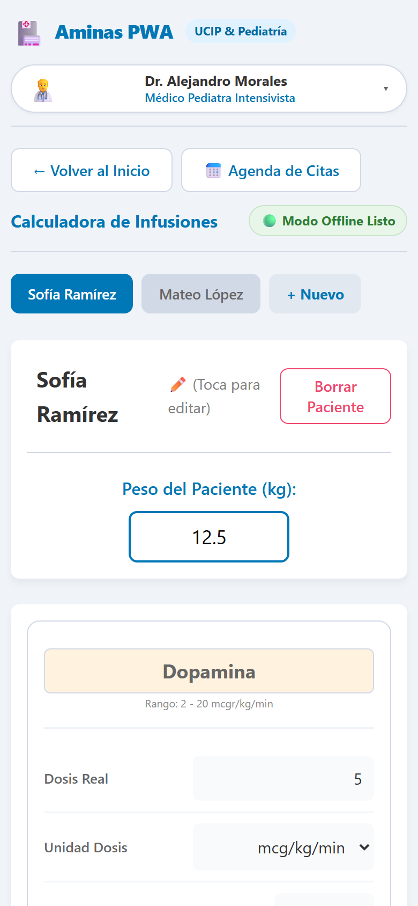

### 5.5 Eliminar un paciente
Toca **Borrar Paciente** y confirma. Siempre debe quedar al menos un paciente. *(Solo Médico Pediatra.)*

---

## 6. Reporte de entrega de guardia

1. En la calculadora toca **📄 Generar Reporte / Entrega de Guardia**.
2. Revisa la ficha: paciente, peso, infusiones activas (dosis, velocidad, dilución y equivalencias) y tu firma.
3. Escribe las **Observaciones Clínicas / Pendientes de Turno**.
4. Elige qué hacer:
   - **💾 Guardar en Historial:** guarda una copia con folio. Si vuelves a tocarlo, actualiza las observaciones sin duplicar el reporte.
   - **📋 Copiar para WhatsApp:** copia un resumen con formato; pégalo en el chat del equipo.
   - **🖨️ Imprimir / Guardar PDF:** abre la impresión; elige tu impresora o *Guardar como PDF*.
5. Toca **Cerrar** (o la tecla *Esc*) para volver.

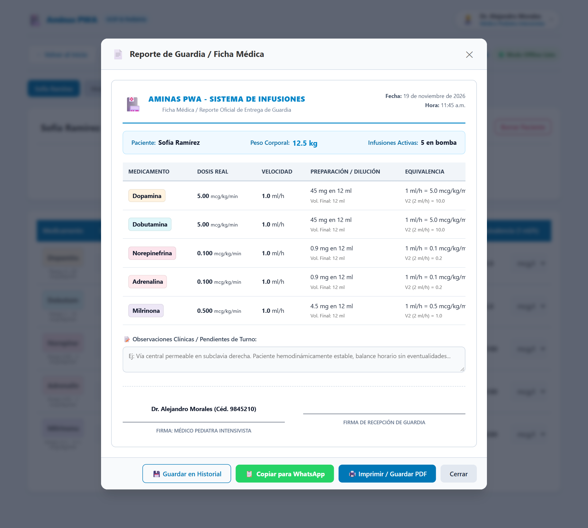

> Solo aparecen las infusiones **activas** (con nombre y con dosis o velocidad mayor a 0).

---

## 7. Historial de reportes

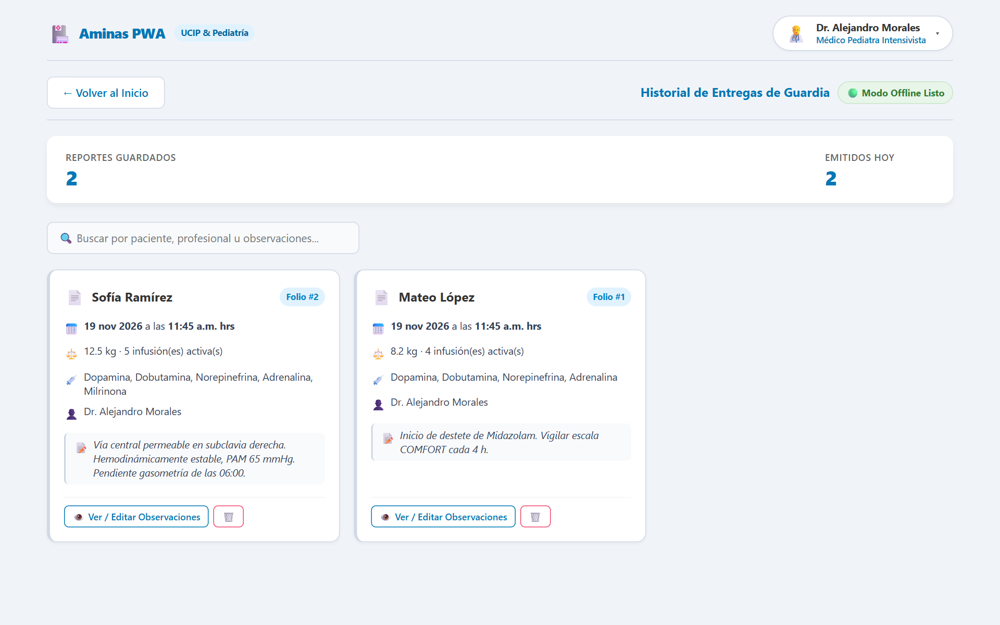

1. Desde el inicio toca **🗂️ Historial de Reportes**.
2. Usa el **buscador** para filtrar por paciente, profesional u observaciones.
3. **👁️ Ver / Editar Observaciones** abre el reporte tal como se guardó (con su fecha y folio originales). Puedes corregir las observaciones y tocar **💾 Actualizar Observaciones**, además de imprimirlo o copiarlo otra vez.
4. **🗑️** elimina el reporte después de confirmar. *(Solo Médico Pediatra.)*

> Los reportes guardados **no cambian** aunque después modifiques las bombas del paciente.

---

## 8. Agenda de citas

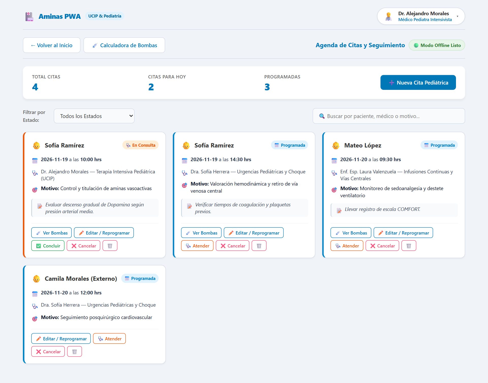

### 8.1 Agendar una cita
1. Toca **➕ Nueva Cita Pediátrica**.
2. Elige el **paciente** (o *Otro paciente* y escribe su nombre si no está registrado).
3. Elige el **profesional responsable**, la **fecha**, la **hora** y el **motivo** (puedes escoger uno sugerido). Las observaciones son opcionales.
4. Toca **💾 Agendar Cita**.

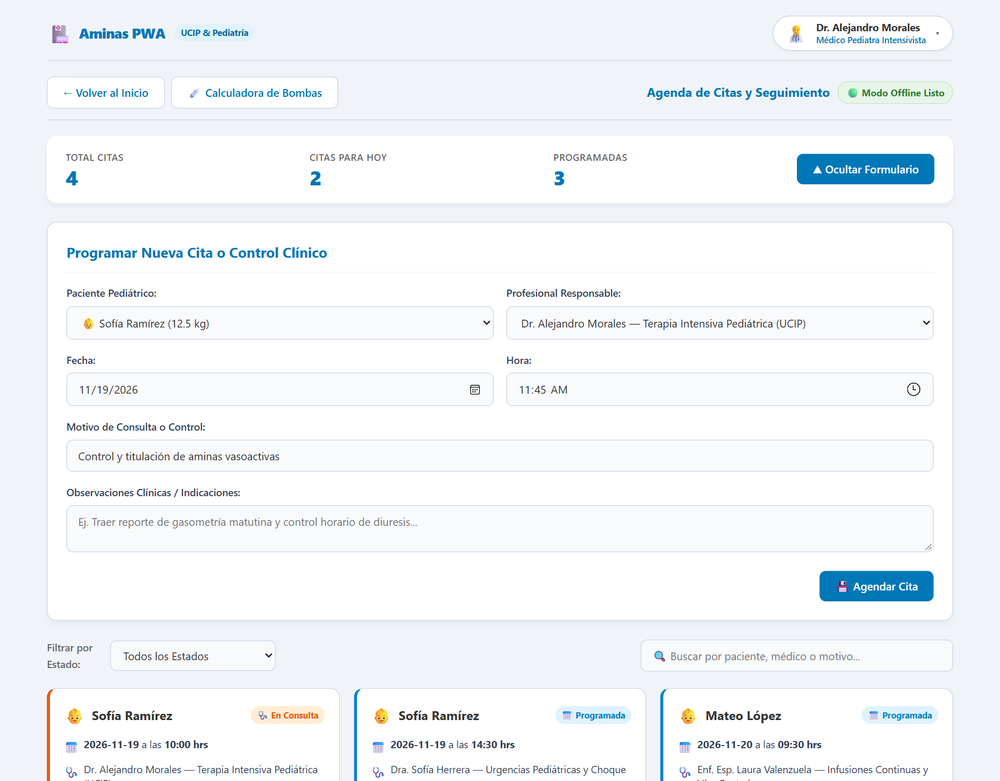

Si falta un dato, o el profesional **ya tiene otra cita a esa misma fecha y hora**, aparece un aviso amarillo y la cita no se guarda:

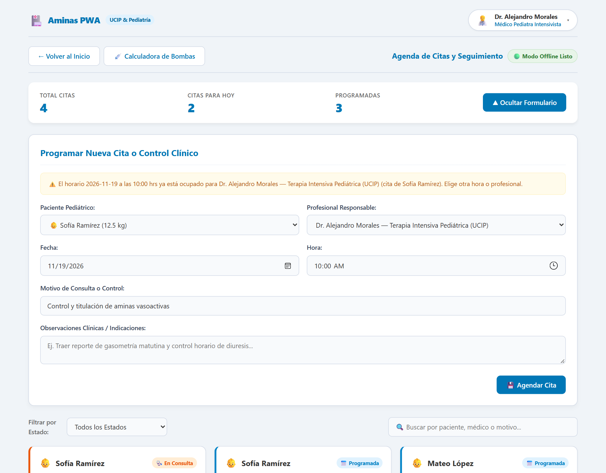

### 8.2 Editar o reprogramar
1. En la tarjeta de la cita toca **✏️ Editar / Reprogramar**.
2. Cambia los datos (por ejemplo, la fecha o la hora) y toca **💾 Guardar Cambios**, o **✕ Cancelar Edición** para descartar.

### 8.3 Ciclo de la cita
| Estado | Cómo se llega | Botón |
| :--- | :--- | :--- |
| 📅 Programada | Al agendar | — |
| 🩺 En Consulta | Cuando llega el paciente | **Atender** |
| ✅ Completada | Al terminar la consulta | **Concluir** |
| ❌ Cancelada | Si no se realizará (libera el horario) | **Cancelar** |

**🗑️** elimina la cita. **💉 Ver Bombas** abre la calculadora del paciente.

### 8.4 Buscar
Usa **Filtrar por Estado** y el **buscador** (paciente, profesional o motivo). Arriba verás el total de citas, las de hoy y las programadas.

---

## 9. Administrar al personal

*(Médico Pediatra y Recepción.)* Abre la píldora con tu nombre.

**Registrar:** pestaña **➕ Registrar Nuevo Doctor/a** → llena nombre, cédula, rol, especialidad, turno y contraseña (dos veces) → **💾 Registrar e Iniciar Turno**. El nuevo profesional queda en turno.

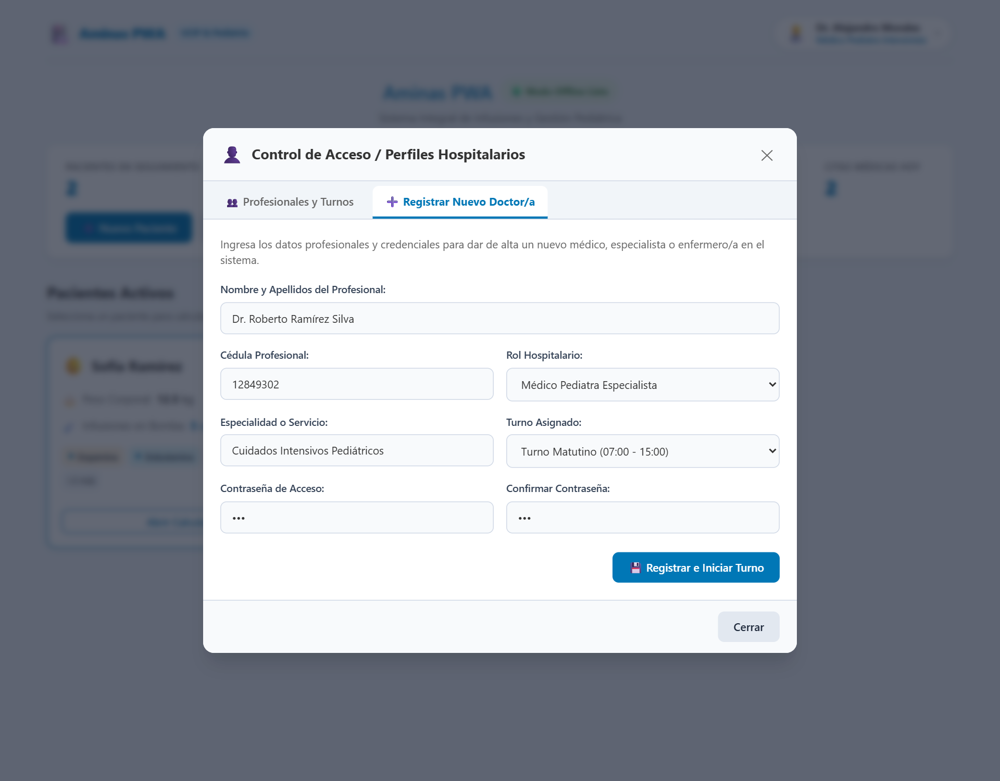

**Editar:** botón **✏️ Editar** en la tarjeta. Deja la contraseña vacía para conservar la actual. Cualquier usuario puede editar **su propio** perfil (sin cambiar su rol).

**Dar de baja:** botón **🗑️** en la tarjeta y confirma. No se puede eliminar al perfil que tiene el turno ni al último Médico Pediatra.

---

## 10. Preguntas frecuentes y solución de problemas

| Situación | Solución |
| :--- | :--- |
| No se calcula la dosis o el fármaco | Revisa que el **peso** sea mayor a 0 y que la velocidad y el diluyente no estén en 0 |
| No veo un botón (Nuevo Paciente, Eliminar, Nueva Cita…) | Tu rol no tiene ese permiso. Cambia al perfil adecuado desde la píldora de usuario |
| Recepción no puede entrar a la calculadora | Es correcto: la calculadora es solo para personal clínico |
| "El horario ya está ocupado" | Ese profesional ya tiene una cita activa a esa hora. Cambia la hora, el profesional, o cancela la otra cita |
| No puedo borrar al único paciente | Siempre debe existir al menos uno. Crea otro primero |
| No se copió el texto para WhatsApp | El navegador bloqueó el portapapeles. Intenta de nuevo o copia el texto desde la ficha |
| Desaparecieron mis datos | Se borraron los datos de navegación del dispositivo o usaste otro navegador. La información se guarda **solo en ese navegador y equipo** |
| En otro celular no veo mis pacientes | Los datos no se sincronizan entre dispositivos |
| La app no muestra los cambios de una versión nueva | Cierra y vuelve a abrir la app con internet; se actualiza sola |
